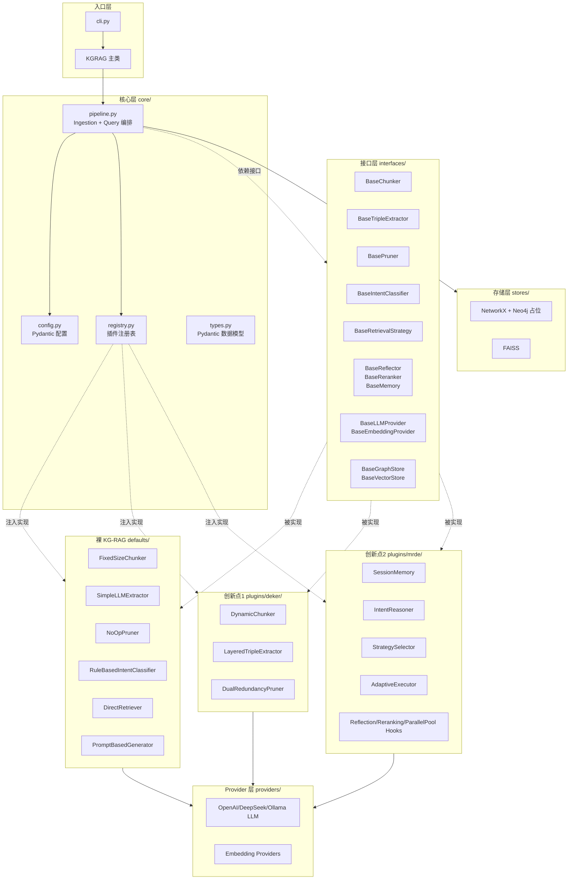

## 产品概述

为"意图感知的图增强检索生成（KG-RAG）"研究构建一个**从零自研、无基础框架依赖、全链路可插拔**的 Python 工程骨架。框架默认即为一个可工作的"裸 KG-RAG"基线（固定分块 + 简单三元组提取 + 直接检索 + LLM 生成），两个研究创新点（**DEKER 知识构建双重增强**、**MRDE 意图感知智能体**）作为可通过 `config.yaml` 一键开关的独立插件叠加其上。

## 核心功能

- **裸 KG-RAG 基线**：文档 → 固定分块 → LLM 提取显式三元组 → NetworkX 图存储 + FAISS 向量索引 → 直接检索（向量 top-k + 1 跳邻居扩展）→ LLM 生成答案，端到端可跑通
- **插件注册表机制**：基于抽象基类 + 装饰器注册表，每个"槽位"（chunker / extractor / pruner / intent_classifier / retriever / strategy / reranker / reflector / memory）通过 `config.slot.active` 指定激活实现，未指定或加载失败自动降级到 defaults
- **创新点1 DEKER 插件骨架**：动态粒度分块器、分层四级三元组提取器、双重冗余剪枝器的完整类结构与接口契约，关键公式实装、难点逻辑 TODO 占位
- **创新点2 MRDE 插件骨架**：Memory / Reasoning（6 类意图分类）/ Decision（策略库）/ Execution（带反馈循环）四模块 + 三个可插拔 Hook（Reflection / Reranking / ParallelPool）
- **Provider 抽象层**：LLMProvider / EmbeddingProvider 统一接口，默认支持 OpenAI / DeepSeek / Ollama 三种后端，通过环境变量切换；测试使用 MockProvider 无需真实 API
- **存储抽象层**：GraphStore 默认 NetworkX 内存实现，Neo4j 实现为占位接口；VectorStore 默认 FAISS 持久化
- **CLI 与示例**：`kgrag ingest` / `kgrag query` 两个子命令 + 4 份示例脚本（vanilla / deker-only / mrde-only / full）
- **验证闭环**：pytest 测试覆盖注册表、端到端 vanilla 跑通、插件开关降级三个关键场景

## 技术栈选型

- **语言**：Python 3.11+
- **核心依赖（最小化）**：
- `networkx` - 内存图存储
- `faiss-cpu` - 向量索引
- `pydantic` >= 2.0 - 数据模型 + 配置校验
- `pyyaml` - 配置加载
- `openai` >= 1.0 - OpenAI / DeepSeek 兼容
- `httpx` - Ollama HTTP 调用
- `numpy` - 向量操作
- `tenacity` - LLM 调用重试
- `rich` - 结构化日志与 CLI 输出
- **开发依赖**：`pytest` / `pytest-asyncio` / `black` / `ruff`
- **可选依赖（extras）**：`sentence-transformers`（本地嵌入）、`neo4j`（图存储切换）、`spacy`（DEKER 启用时使用）

## 实施策略

**主路径：注册表驱动的依赖注入管线**。核心 Pipeline 在构造时只认接口（ABC），不认具体类；通过全局 `Registry` 单例按 `config.<slot>.active` 字符串查表拿实现。这样做的好处：

1. 创新点完全解耦——`core/` 下任何文件都不会 `import plugins.*`，只反向依赖
2. 关闭创新点就是改一行 yaml，降级到 `defaults/` 下对应实现
3. 未来新增研究点（如创新点3）只需 `pip install` 新插件包并在 config 里 active 即可

**关键技术决策与权衡**：

1. **为何自研而非基于 LangChain/LlamaIndex**：创新点需要在论文中清晰可见；LangChain 的 Chain/Runnable 抽象会把 DEKER/MRDE 拆散到多个组件内部难以独立论证；自研编排代码量可控（Pipeline 核心 <300 行），换来的是全链路透明
2. **为何 src layout**：避免 import 歧义、便于 `pip install -e .` 编辑安装、pytest 不会误收集源码
3. **为何 async 仅用于 query 路径**：ingest 路径天然批处理不需要并发；query 路径下 MRDE 的 ParallelPool 需要真并行，async def 是必要的
4. **为何 Pydantic v2 数据模型**：Chunk/Triple/Intent/ReasoningPlan 这些核心数据结构穿越多模块边界，强类型校验能在开发期抓到 95% 的接口错配问题
5. **为何 Mock Provider 优先**：骨架阶段零 API 成本让测试和 demo 可重复、可 CI

**性能与可靠性要点**：

- LLM 调用统一走 tenacity 指数退避重试（3 次，最长 10s）
- Embedding 批量化（一次 encode 全部 chunks），避免 N 次 API 调用
- FAISS 索引持久化到磁盘（.faiss + .pkl 元数据），ingest 后 query 可冷启动复用
- NetworkX 图序列化为 GraphML / pickle，支持增量 ingest
- 插件加载失败不影响框架启动，仅降级 + warning log

**避免技术债**：

- 所有接口只定义契约，不含任何业务默认实现（除了 BaseMemory 的极简默认）
- 插件内部不共享状态，状态通过 Pipeline 传递
- 配置层 Pydantic 模型严格校验，yaml 字段错误启动时就报错
- 不使用全局可变状态，Registry 虽是全局单例但只暴露只读查询 + 装饰器注册

## 架构设计



## 目录结构

```
/Users/teng/Projects/my/agent-graph-rag/
├── pyproject.toml                          # [NEW] 项目元数据 + 依赖声明，Python 3.11+，src layout，声明 black/ruff/pytest 配置，extras: [neo4j, st, spacy, dev]
├── README.md                               # [NEW] 项目概述、架构图、Quick Start（裸框架 / 启用 DEKER / 启用 MRDE / 全启用 四套命令），引用 my/ 下设计材料
├── .gitignore                              # [NEW] Python 通用忽略 + .env + *.faiss + data/output
├── .env.example                            # [NEW] 环境变量模板：LLM_PROVIDER / OPENAI_API_KEY / OPENAI_BASE_URL / OLLAMA_HOST / EMBEDDING_PROVIDER
│
├── configs/                                # [NEW] 四份 yaml 配置
│   ├── default.yaml                        # 裸 KG-RAG 默认配置，所有插件 active 指向 defaults 下实现
│   ├── deker_enabled.yaml                  # 仅启用 DEKER，MRDE 全关闭
│   ├── mrde_enabled.yaml                   # 仅启用 MRDE，DEKER 全关闭
│   └── all_enabled.yaml                    # 全部启用
│
├── src/kgrag/                              # [NEW] 主包 src layout
│   ├── __init__.py                         # 暴露顶层 KGRAG 类、version
│   ├── cli.py                              # argparse 实现 ingest/query 两个子命令
│   │
│   ├── core/                               # 核心层，禁止 import plugins/*
│   │   ├── __init__.py
│   │   ├── types.py                        # Pydantic 数据模型：Document/Chunk/Triple/Entity/Query/Intent/ReasoningPlan/RetrievalResult/Answer/QualityFeedback
│   │   ├── config.py                       # 配置加载：yaml+env+Pydantic 校验，SlotConfig 嵌套模型
│   │   ├── registry.py                     # 核心注册表：@register(slot, name) 装饰器 + Registry 单例 + get(slot, name) + 降级逻辑
│   │   ├── pipeline.py                     # IngestionPipeline + QueryPipeline 两个编排类，依赖注入
│   │   ├── logging.py                      # rich handler 封装，结构化打点工具
│   │   └── exceptions.py                   # KGRAGError 基类 + PluginNotFound/ConfigError/ProviderError 等
│   │
│   ├── interfaces/                         # 抽象基类层，所有 BaseXxx 都在这
│   │   ├── __init__.py                     # 集中导出所有基类
│   │   ├── chunker.py                      # BaseChunker.chunk(text, doc_id) -> List[Chunk]
│   │   ├── extractor.py                    # BaseTripleExtractor.extract(chunk) -> List[Triple]
│   │   ├── pruner.py                       # BasePruner.prune(triples, graph) -> List[Triple]
│   │   ├── intent_classifier.py            # BaseIntentClassifier.classify(query, context) -> Intent
│   │   ├── retriever.py                    # BaseRetriever.retrieve(query, top_k) -> RetrievalResult
│   │   ├── strategy.py                     # BaseRetrievalStrategy.execute(query, ctx) -> RetrievalResult (async)
│   │   ├── reflector.py                    # BaseReflector.evaluate(query, answer, ctx) -> QualityFeedback (async)
│   │   ├── reranker.py                     # BaseReranker.rerank(query, candidates) -> List (async)
│   │   ├── memory.py                       # BaseMemory.get_context/save_interaction
│   │   ├── generator.py                    # BaseAnswerGenerator.generate(query, retrieval) -> Answer
│   │   ├── llm_provider.py                 # BaseLLMProvider.complete/stream (async)
│   │   ├── embedding_provider.py           # BaseEmbeddingProvider.encode(texts) -> np.ndarray
│   │   ├── graph_store.py                  # BaseGraphStore.add_triple/get_neighbors/query
│   │   └── vector_store.py                 # BaseVectorStore.add/search/save/load
│   │
│   ├── defaults/                           # 裸 KG-RAG 默认实现，所有类通过 @register 注册到 defaults.* 名字
│   │   ├── __init__.py                     # import 所有子模块触发注册
│   │   ├── fixed_chunker.py                # FixedSizeChunker：按 token 固定窗口 + overlap，实装
│   │   ├── llm_extractor.py                # SimpleLLMExtractor：单 prompt 提取显式三元组，JSON 解析，实装
│   │   ├── noop_pruner.py                  # NoOpPruner：原样返回，实装（一行）
│   │   ├── rule_intent_classifier.py       # RuleBasedIntentClassifier：全部归为 factual，实装
│   │   ├── direct_retriever.py             # DirectRetriever：向量 top-k + 1 跳邻居扩展，实装
│   │   ├── prompt_generator.py             # PromptBasedGenerator：context+query→LLM→Answer，实装
│   │   ├── no_memory.py                    # NoMemory：无状态实现，实装
│   │   ├── no_reflection.py                # NoOpReflector：永远返回 quality=1.0，实装
│   │   └── no_reranker.py                  # NoOpReranker：原序返回，实装
│   │
│   ├── providers/                          # LLM / Embedding 接入
│   │   ├── __init__.py                     # from_env() 工厂：根据 LLM_PROVIDER / EMBEDDING_PROVIDER 切换
│   │   ├── llm/
│   │   │   ├── __init__.py
│   │   │   ├── openai_provider.py          # OpenAIProvider：兼容 OpenAI/DeepSeek（base_url 切换），tenacity 重试
│   │   │   ├── ollama_provider.py          # OllamaProvider：httpx 调 /api/chat
│   │   │   └── mock_provider.py            # MockLLMProvider：按 prompt 关键词返回预设响应，用于测试
│   │   └── embedding/
│   │       ├── __init__.py
│   │       ├── openai_embedding.py         # OpenAIEmbeddingProvider
│   │       ├── ollama_embedding.py         # OllamaEmbeddingProvider
│   │       ├── sentence_transformer_embedding.py  # 可选 extras，bge-m3 默认
│   │       └── mock_embedding.py           # MockEmbeddingProvider：hash→确定性向量，测试用
│   │
│   ├── stores/                             # 图/向量存储
│   │   ├── __init__.py
│   │   ├── graph/
│   │   │   ├── __init__.py
│   │   │   ├── networkx_store.py           # NetworkXGraphStore：实装 add_triple/get_neighbors/persist（pickle）
│   │   │   └── neo4j_store.py              # Neo4jGraphStore：所有方法 raise NotImplementedError，接口齐全，docstring 注明未来扩展
│   │   └── vector/
│   │       ├── __init__.py
│   │       └── faiss_store.py              # FAISSVectorStore：IndexFlatIP，持久化 .faiss+.pkl
│   │
│   └── plugins/                            # 两大创新点插件，与 defaults 平级
│       ├── __init__.py                     # 插件发现：根据 config.plugins.enabled 列表动态 import 子包
│       ├── deker/                          # 创新点1：知识构建双重增强
│       │   ├── __init__.py                 # @register 注册 DynamicChunker/LayeredTripleExtractor/DualRedundancyPruner 三个组件
│       │   ├── config_schema.py            # DEKERConfig Pydantic 子模型：min/max/base_chunk_size, similarity_threshold 等
│       │   ├── dynamic_chunker.py          # DynamicChunker(BaseChunker)：complexity+density 算法骨架（可返回 0.5 stub），compute_adaptive_chunk_size 公式实装，句子级分块循环实装
│       │   ├── layered_extractor.py        # LayeredTripleExtractor(BaseTripleExtractor)：4 层 _extract_* 方法，L1 复用 SimpleLLMExtractor 实装，L2-L4 TODO 返回空列表+warning
│       │   └── dual_pruner.py              # DualRedundancyPruner(BasePruner)：相似性冗余聚类实装（embedding+阈值），传递性冗余 TODO 占位
│       │
│       └── mrde/                           # 创新点2：意图感知智能体
│           ├── __init__.py                 # @register 注册 Memory/IntentClassifier/Reasoner/Selector/Executor/Hooks 所有组件
│           ├── config_schema.py            # MRDEConfig：max_history, quality_threshold, enabled_hooks 列表等
│           ├── agent.py                    # MRDEAgent 主入口：process_query 串联 M-R-D-E 四阶段，实装编排逻辑
│           ├── memory.py                   # SessionMemory(BaseMemory) + InMemorySessionStorage，实装基础功能
│           ├── intent_classifier.py        # LLMIntentClassifier + 规则兜底：6 类意图 prompt+parse，实装
│           ├── reasoning.py                # IntentReasoner：意图→ReasoningPlan 映射表，实装
│           ├── decision.py                 # StrategySelector：根据 plan.strategy_name 从策略注册表取实例，实装
│           ├── execution.py                # AdaptiveExecutor：主 while 循环骨架（最多 max_iter 次），质量评估调用 Reflector，反馈调整 TODO
│           ├── strategies/                 # 6 个检索策略
│           │   ├── __init__.py
│           │   ├── direct.py               # DirectRetrievalStrategy：复用 defaults.DirectRetriever，实装
│           │   ├── multi_hop.py            # MultiHopStrategy：骨架 + pseudo-impl（BFS 2-hop）
│           │   ├── parallel.py             # ParallelRetrievalStrategy：asyncio.gather 骨架
│           │   ├── iterative.py            # IterativeReasoningStrategy：分解-检索-组合骨架
│           │   ├── expansion.py            # ExpansionStrategy：邻居扩展骨架
│           │   └── context_aware.py        # ContextAwareStrategy：复用 Memory 上下文，骨架
│           └── hooks/                      # 可插拔子模块
│               ├── __init__.py
│               ├── reflection_hook.py      # LLMReflectionHook(BaseReflector)：LLM 评估 relevance/completeness，骨架
│               ├── reranking_hook.py       # CrossEncoderRerankingHook(BaseReranker)：sentence-transformers cross-encoder，骨架
│               └── parallel_pool_hook.py   # ParallelRetrievalPool：asyncio 子检索池骨架
│
├── examples/                               # [NEW] 四份端到端示例
│   ├── demo_vanilla.py                     # 用 configs/default.yaml，Mock Provider，端到端跑通
│   ├── demo_deker.py                       # 用 configs/deker_enabled.yaml
│   ├── demo_mrde.py                        # 用 configs/mrde_enabled.yaml
│   ├── demo_full.py                        # 用 configs/all_enabled.yaml
│   └── data/
│       └── sample.txt                      # 一段 3-5 段的英文文本（可用开源历史人物/公司介绍），便于测试多跳
│
└── tests/                                  # [NEW] pytest 测试
    ├── conftest.py                         # pytest 夹具：mock_llm / mock_embedding / tmp_faiss_dir / sample_config
    ├── test_registry.py                    # 测试 @register 装饰器、get() 查表、未注册降级、重复注册覆盖警告
    ├── test_config.py                      # 测试 yaml 加载 + env 覆盖 + Pydantic 校验错误路径
    ├── test_types.py                       # 测试 Pydantic 数据模型验证
    ├── test_pipeline_vanilla.py            # 端到端：ingest 示例文本 → query → 得到非空 answer，用 Mock Provider
    ├── test_plugins_disabled.py            # 启用 deker_enabled.yaml 但手动 monkeypatch 卸载插件模块，验证降级到 defaults
    ├── test_defaults_chunker.py            # FixedSizeChunker 边界：空文本、超大文本、overlap 正确
    ├── test_defaults_extractor.py          # SimpleLLMExtractor：mock LLM 返回合法/非法 JSON 的行为
    ├── test_deker_dynamic_chunker.py       # DynamicChunker：公式 compute_adaptive_chunk_size 在不同 score 下的边界
    ├── test_mrde_intent.py                 # LLMIntentClassifier：6 类意图关键词 mock 能正确分类
    └── test_stores_faiss.py                # FAISSVectorStore 持久化 round-trip
```

## 关键代码结构

```python
# src/kgrag/core/registry.py —— 唯一需要提前固化的核心契约
from typing import Callable, TypeVar, Type
T = TypeVar("T")

class Registry:
    """全局插件注册表。slot ∈ {chunker, extractor, pruner,
    intent_classifier, retriever, strategy, reranker, reflector,
    memory, generator, llm_provider, embedding_provider,
    graph_store, vector_store}"""

    def register(self, slot: str, name: str) -> Callable[[Type[T]], Type[T]]: ...
    def get(self, slot: str, name: str) -> Type: ...
    def get_or_default(self, slot: str, name: str, default_name: str) -> Type: ...
    def list_slot(self, slot: str) -> list[str]: ...

# src/kgrag/core/types.py —— 穿越模块边界的数据契约
class Chunk(BaseModel):
    chunk_id: str
    doc_id: str
    text: str
    token_count: int
    metadata: dict = {}  # complexity/density/position 等扩展字段

class Triple(BaseModel):
    head: str
    relation: str
    tail: str
    confidence: float = 1.0
    source_chunk_id: str | None = None
    type: Literal["explicit", "implicit", "schema_based", "cross_sentence"] = "explicit"

class Intent(BaseModel):
    type: Literal["factual","analytical","comparative","multi_hop","exploratory","follow_up"]
    confidence: float
    complexity: Literal["simple","medium","high","contextual"]
    features: dict = {}

class RetrievalResult(BaseModel):
    items: list[dict]  # {node_id, text, score, ...}
    strategy: str
    hops: int = 1
    stats: dict = {}
```

## 实施注意事项

- **依赖方向**：`core/` → `interfaces/` 单向依赖；`defaults/` 和 `plugins/` 都依赖 `interfaces/` 和 `providers/`；`core/pipeline.py` 不得 import 任何 `defaults/` 或 `plugins/` 的具体类，全通过 Registry 查表
- **注册触发时机**：`KGRAG.__init__` 中根据 config 显式 `importlib.import_module` 对应子包触发 `@register` 副作用；未启用的插件不导入，避免可选依赖缺失导致启动失败
- **降级日志**：Registry.get_or_default 降级时 `logger.warning("Slot={slot} plugin={name} not found, fallback to {default}")`，便于答辩演示时清晰看到
- **Mock 优先策略**：所有测试默认用 MockLLMProvider/MockEmbeddingProvider，`pytest -q` 不需要任何 API key
- **性能**：embedding 批量调用（ingest 时一次 encode 所有 chunks），FAISS 用 IndexFlatIP（MVP 阶段够用，千量级文档 <1s）
- **可选依赖处理**：`from sentence_transformers import ...` 包在 try/except 内，未安装时给出友好提示而非 ImportError
- **日志规范**：关键节点（chunk 数、triple 数、intent 类型、strategy 名、latency）通过 `logger.info(..., extra={...})` 结构化打点，rich handler 友好展示
- **未来 Neo4j 扩展路径**：`Neo4jGraphStore` 所有方法签名与 `NetworkXGraphStore` 完全一致，未来替换只需在 config 里改 `graph_store.active: neo4j` 并填 URI
- **不修改 my/ 下已有材料**，仅新建项目骨架

## Agent Extensions

### SubAgent

- **code-explorer**
- Purpose: 工作区当前除 my/ 下 5 份 Markdown 设计材料外无任何代码，但执行阶段需要按 10+ 个目录、40+ 个文件新建结构。使用 code-explorer 可在动工前再次确认 workspace 根目录无残留冲突文件、my/ 材料中关于 DEKER 公式和 MRDE 意图分类 prompt 的最终细节，避免实装时与设计文档不一致
- Expected outcome: 确认 workspace 无冲突路径、提取 my/ 中 DEKER 自适应分块公式和 MRDE 6 类意图 prompt 模板的精确文本，为 defaults/ 和 plugins/ 实装提供 ground truth

### Skill

- **humanizer-zh**
- Purpose: README.md 和每个模块 docstring（尤其是 plugins/deker、plugins/mrde 中解释创新点动机的段落）需要中文撰写且避免 AI 写作痕迹，用于答辩展示时显得自然专业
- Expected outcome: README 和核心 docstring 的中文段落通过 humanizer-zh 处理后去除模板化连接词和夸张表述，读起来像研究者本人撰写