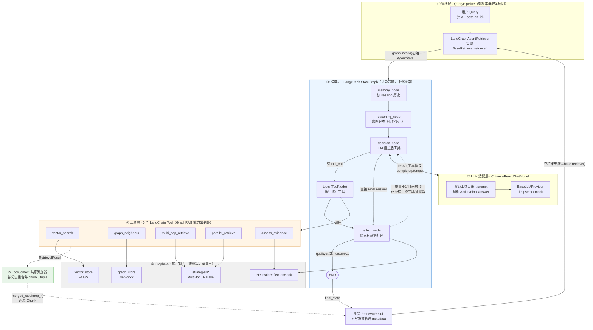
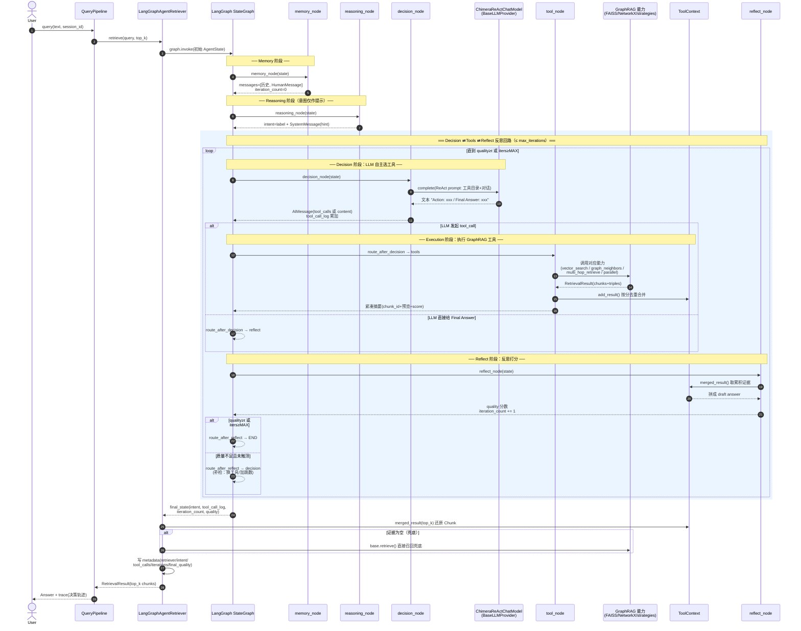
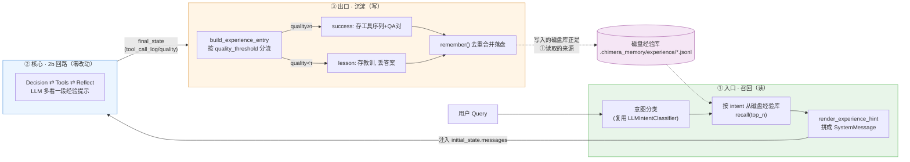

# 创新点二：IntentAgent —— 意图感知的智能检索体

> 本文是创新点二的**完整实装文档**，由三条演化阶段合并而成，对应代码 `src/chimera_rag/plugins/intent_agent/`：
>
> | 阶段 | 代号 | 一句话定位 |
> |---|---|---|
> | **A · 静态路由版** | IntentAgent（= 设计材料中的 `MRDE`） | M-R-D-E 四阶段 + 6 策略 + 3 Hook，意图 → 单策略**静态查表** |
> | **B · 动态编排版** | LangGraph Agentic 检索 | 把 Decision 的静态查表升级为 **LangGraph 状态图 + LLM 自主选择/组合多工具 + 反思回路** |
> | **C · 经验记忆增强** | Experiential Memory | 类 Claude Code 的磁盘记忆，把检索过程中的**成功路径 / 反思教训 / 高质量 QA** 按意图沉淀、跨 session 召回复用 |
>
> 三阶段是**逐级增量**关系：B 复用 A 的意图分类与底层策略，C 挂在 B 的状态图入口/出口。三者都对外实现同一个 `BaseRetriever.retrieve(query, top_k) -> RetrievalResult` 契约，通过一行 yaml 切换、可独立消融。
>
> **作用阶段**：Query（查询）　**启用方式**：`configs/*.yaml` 中 `plugins.intent_agent.enabled: true`，并按需把 `query.retriever.active` 切到 `intent_agent.strategy_selector`（A）或 `intent_agent.langgraph`（B/C）。

---

## 📖 目录

- [第一部分 · 静态路由版 IntentAgent（M-R-D-E）](#第一部分--静态路由版-intentagentm-r-d-e)
  - [A1. 插件定位](#a1-插件定位)
  - [A2. 四阶段 M-R-D-E 总览](#a2-四阶段-m-r-d-e-总览)
  - [A3. 阶段 1 — Memory（会话级记忆）](#a3-阶段-1--memory会话级记忆)
  - [A4. 阶段 2 — Reasoning（意图 + 计划）](#a4-阶段-2--reasoning意图--计划)
  - [A5. 阶段 3 — Decision（策略选择器）](#a5-阶段-3--decision策略选择器)
  - [A6. 阶段 4 — Execution（6 种检索策略）](#a6-阶段-4--execution6-种检索策略)
  - [A7. 三个可插拔 Hook](#a7-三个可插拔-hook)
  - [A8. IntentAgentRetriever：四阶段装配](#a8-intentagentretriever四阶段装配)
  - [A9. 在 QueryPipeline 中的接入](#a9-在-querypipeline-中的接入)
  - [A10. 对应测试](#a10-对应测试)
  - [A11. 与 AdaGraph 的正交性](#a11-与-adagraph-的正交性)
- [第二部分 · 动态编排版 LangGraph Agentic 检索](#第二部分--动态编排版-langgraph-agentic-检索)
  - [B1. 一句话定位与动机](#b1-一句话定位与动机)
  - [B2. 设计目标与硬约束](#b2-设计目标与硬约束)
  - [B3. 整体架构：第三种检索器](#b3-整体架构第三种检索器)
  - [B4. 工具层：把现有原子能力封装成 LangChain Tools](#b4-工具层把现有原子能力封装成-langchain-tools)
  - [B5. 编排层：LangGraph 状态图](#b5-编排层langgraph-状态图)
  - [B6. 反思回路：把 TODO 真正落地](#b6-反思回路把-todo-真正落地)
  - [B7. LLM 适配：复用现有 providers](#b7-llm-适配复用现有-providers)
  - [B8. 配置开关](#b8-配置开关)
  - [B9. 依赖与降级策略](#b9-依赖与降级策略)
  - [B10. 与现有架构的兼容性](#b10-与现有架构的兼容性)
  - [B11. 消融实验设计](#b11-消融实验设计)
- [第三部分 · 经验记忆增强（Experiential Memory）](#第三部分--经验记忆增强experiential-memory)
  - [C1. 一句话定位与动机](#c1-一句话定位与动机)
  - [C2. 三段式闭环](#c2-三段式闭环)
  - [C3. 沉淀什么：三类经验条目](#c3-沉淀什么三类经验条目)
  - [C4. 怎么召回：意图标签做索引键](#c4-怎么召回意图标签做索引键)
  - [C5. 怎么沉淀：检索结束后的经验写回](#c5-怎么沉淀检索结束后的经验写回)
  - [C6. 持久化：类 Claude Code 的磁盘记忆](#c6-持久化类-claude-code-的磁盘记忆)
  - [C7. 接口设计：扩展而非破坏 BaseMemory](#c7-接口设计扩展而非破坏-basememory)
  - [C8. 顺势盘活意图分类](#c8-顺势盘活意图分类)
  - [C9. 配置开关与装配注入](#c9-配置开关与装配注入)
  - [C10. 兼容性与消融实验](#c10-兼容性与消融实验)
- [对应测试总览](#对应测试总览)
- [关联文档](#关联文档)

---

# 第一部分 · 静态路由版 IntentAgent（M-R-D-E）

> 这是创新点二的**地基**：把"一刀切的裸向量检索"升级为"先理解意图、再选对策略"的四阶段智能体。B/C 两阶段的意图分类、6 类意图、会话记忆都源自这里。

## A1. 插件定位

IntentAgent 在 `QueryPipeline` 中同时占据两个主要插槽，并在其内部再挂接 4 个子插槽：

| 对外插槽 | 注册名 | 作用 |
|---|---|---|
| `intent_classifier` | `intent_agent.llm` | 6 类意图分类 |
| `retriever` | `intent_agent.strategy_selector` | 四阶段 M-R-D-E 编排器 |

`intent_agent.strategy_selector` 这个 retriever 内部再从注册表中拉取：

| 内部插槽 | 注册名 | 实现 |
|---|---|---|
| `memory` | `intent_agent.session` | 会话级历史 |
| `strategy`（6 个） | `intent_agent.{direct / multi_hop / parallel / iterative / expansion / context_aware}` | 6 种检索策略 |
| `reflector` | `intent_agent.heuristic` | 启发式答案质量评估（hook） |
| `reranker` | `intent_agent.token_overlap` | Jaccard 重排（hook） |
| — 非 slot，工具类 — | `ParallelRetrievalPool` | asyncio Semaphore 限流池（hook） |

开关方式（摘自 `configs/deepseek_full.yaml`）：

```yaml
query:
  intent_classifier:
    active: intent_agent.llm
    params: { confidence_threshold: 0.55 }
  retriever:
    active: intent_agent.strategy_selector
    params: { top_k: 5, neighbor_hops: 1 }

plugins:
  intent_agent:
    enabled: true
    memory:            { max_history: 10 }
    intent_classifier: { confidence_threshold: 0.55 }
    strategies:
      enabled: [direct, multi_hop, parallel, iterative, expansion, context_aware]
    hooks:
      reflection:    { enabled: false }
      reranking:     { enabled: false }
      parallel_pool: { enabled: true, max_workers: 4 }
```

关闭时只需 `enabled: false`，并把 `intent_classifier.active` 回到 `defaults.rule`、`retriever.active` 回到 `defaults.direct`——`ChimeraRAG.toggle_plugin("intent_agent", False)` 已经自动完成这一切（见 `src/chimera_rag/__init__.py::toggle_plugin`）。

---

## A2. 四阶段 M-R-D-E 总览

四个模块在代码中分别落到 4 个文件：

```
Memory         → memory.py            SessionMemory
  │
  ▼
Reasoning      → intent_classifier.py LLMIntentClassifier  + rule_based_classify
                 reasoning.py         IntentReasoner
  │
  ▼
Decision       → agent.py             StrategySelector
  │
  ▼
Execution      → strategies/*.py      6 种策略（均 async）
  │
  └──► Hooks   → hooks/*.py           Reflection / Reranking / ParallelPool
```

整个四阶段**对 `QueryPipeline` 透明**：`QueryPipeline` 看见的只是一个实现了 `BaseRetriever.retrieve(query, top_k) -> RetrievalResult` 的对象——这个对象叫 `IntentAgentRetriever`（`agent.py`），它才是四阶段真正的装配车间。

---

## A3. 阶段 1 — Memory（会话级记忆）

### A3.1 类与接口

```python
# src/chimera_rag/plugins/intent_agent/memory.py
@register("memory", "intent_agent.session")
class SessionMemory(BaseMemory):
    def __init__(self, max_history: int | None = 10): ...
    def append(self, session_id: str, turn: str): ...
    def get_history(self, session_id: str) -> list[str]: ...
    def clear(self, session_id: str): ...
```

底层用 `collections.deque(maxlen=max_history)` 实现 **append-only + 自动窗口截断**。`max_history=None` 表示不截断（主要给测试用）；`max_history ≤ 0` 在构造时直接报 `ValueError`，符合"Pydantic 强类型 + 严格校验"的整体风格。

### A3.2 与检索的协作方式

Memory 本身不感知策略。协作发生在 `IntentAgentRetriever.retrieve()` 的开头：

```python
history = []
if self.memory and query.session_id:
    history = self.memory.get_history(query.session_id)
```

历史拿到后，会被放进 `plan.params["history"]`，等 `ContextAwareStrategy`（follow_up 意图专用）取用。**策略对 Memory 没有硬依赖**——它只读 plan 里的参数袋，符合"依赖方向强约束"的总则。

一次检索结束后，当前轮再 append 回去：

```python
if self.memory and query.session_id:
    self.memory.append(query.session_id, query.text)
```

---

## A4. 阶段 2 — Reasoning（意图 + 计划）

### A4.1 6 类意图

`core/types.py::IntentLabel` 用 `Literal` 类型锁定下列 6 项，任何其他字符串都无法构造合法 `Intent`：

| label | 典型表述 | 对应策略 |
|---|---|---|
| `factual` | who / what / when / where | `direct` |
| `analytical` | why / how come / explain why | `iterative` |
| `comparative` | compare / vs / difference between | `parallel` |
| `multi_hop` | impact / influence / relation between A and B | `multi_hop` |
| `exploratory` | tell me about / explain / overview | `expansion` |
| `follow_up` | and / then / what about her? / 单独代词 | `context_aware` |

这一映射由 `reasoning.py::_INTENT_TO_STRATEGY` 的查表完成，并为每个意图附带可供 UI 展示的 `steps` 列表（例如 "Decompose the question into sub-questions" / "BFS multi-hop expansion over the graph"）。

### A4.2 LLM + 规则 双路分类器

`intent_classifier.py::LLMIntentClassifier` 的执行顺序是**先 LLM，后规则兜底**：

1. 用 `CLASSIFY_PROMPT`（英文 + JSON 约束）向 LLM 发一次 completion；
2. `_safe_parse_label()`：
   - 先剥离 markdown 代码围栏；
   - 尝试 `json.loads`；
   - 失败则贪心提取最外层 `{...}` 再 parse；
   - 校验 `label ∈ CANONICAL_LABELS` 且 `confidence ∈ [0,1]`；
3. 若以上任何一步失败，或 `confidence < threshold`（默认 0.6），或 LLM 调用抛异常 → 走 `rule_based_classify(query)`。

### A4.3 规则兜底的 7 条正则

顺序有意义（从最特殊到最一般）：

```
comparative  : \b(compare|comparison|vs\.?|difference between)\b
multi_hop    : \b(impact|effect|influence|relation|between \w+ and \w+)\b
analytical   : \b(why|how come|explain why)\b
follow_up    : ^(and|then|what about|how about)\b  |  \b(her|him|them|it|this|that|these|those)\b\s*\??$
exploratory  : \b(tell me about|explain|describe|overview)\b
factual      : \b(who|what|when|where|which)\b
default      : factual (confidence=0.4)
```

这套规则的意义不是"想要做规则分类"，而是**保证在 Mock Provider / 零 API key 场景下，`tests/test_intent_agent_classifier.py` 能稳定覆盖 6 类意图**——这正是"Mock 优先"的兑现方式。

### A4.4 IntentReasoner：纯函数映射

`reasoning.py::IntentReasoner.plan(query, intent) -> ReasoningPlan` 是一个无副作用的查表函数。它把 `Intent` 转成 `ReasoningPlan(intent, strategy_name, steps, params)`，并在 `query.session_id` 存在时把它塞到 `params["session_id"]`。没有 LLM 调用、没有 I/O，利于单测稳定。

---

## A5. 阶段 3 — Decision（策略选择器）

`agent.py::StrategySelector` 只做一件事：

```python
name = f"intent_agent.{plan.strategy_name}"
cls = registry.get("strategy", name)   # 查表
return cls(retriever=self.base_retriever)
```

两个设计细节：

1. **缓存**：同一 session 多次触发同一策略不会反复构造（`self._cache`）；
2. **兜底**：`registry.get` 抛 `PluginNotFoundError` 时，logger.warning 后回退到 `intent_agent.direct`。这保证"LLM 幻觉出不存在的策略名"也不会让系统崩掉，而是优雅降级。

这种"**查表 + fallback 到 direct**"的模式让**第三方新增策略时无需改 IntentAgent 本体**——只要用 `@register("strategy", "intent_agent.my_new")` 就会被 Decision 阶段正确发现。

> 📌 这张"意图 → 单策略"的静态查表，正是第二部分 LangGraph 动态编排版要升级的对象。

---

## A6. 阶段 4 — Execution（6 种检索策略）

全部策略继承 `BaseRetrievalStrategy`（`interfaces/strategy.py`，async 接口），签名统一为：

```python
async def execute(self, query: Query, plan: ReasoningPlan) -> RetrievalResult: ...
```

| 策略 | 注册名 | 对应意图 | 核心逻辑 |
|---|---|---|---|
| **DirectStrategy** | `intent_agent.direct` | factual | 直接委托 base retriever 一次 top-k 检索 |
| **MultiHopStrategy** | `intent_agent.multi_hop` | multi_hop | 临时把 `retriever.neighbor_hops` 放大到 `max(original, 2)`，检索后 try/finally 还原 |
| **ParallelStrategy** | `intent_agent.parallel` | comparative | 用正则 `\s+(and|vs|versus|compared to)\s+` 切 sub-query，`asyncio.gather` 并发，按 chunk_id 去重合并（取最高 score） |
| **IterativeStrategy** | `intent_agent.iterative` | analytical | 单轮直检（多轮分解为预留增强项） |
| **ExpansionStrategy** | `intent_agent.expansion` | exploratory | 在 `neighbor_hops` 基础上再加 `extra_hops=2`，取更广邻域 |
| **ContextAwareStrategy** | `intent_agent.context_aware` | follow_up | 从 `plan.params["history"]` 取最近 N 轮拼到 query 前，`session_id` 保留透传 |

### A6.1 MultiHop / Expansion 的可逆副作用

两个策略都需要临时修改 `base_retriever.neighbor_hops`，采用 `try/finally` 还原：

```python
original = getattr(self.retriever, "neighbor_hops", None)
try:
    if original is not None:
        self.retriever.neighbor_hops = ...
    res = self.retriever.retrieve(query, top_k=self.top_k)
finally:
    if original is not None:
        self.retriever.neighbor_hops = original
```

这是并发策略共用同一 base retriever 时**不会相互污染**的前提。

### A6.2 Parallel 的合并逻辑

```
for each sub-query (A, B, ...):
    run retrieve(sub) concurrently via asyncio.gather
merge chunks: dict[chunk_id -> (chunk, max_score)]  （同一 chunk 只记一次，取最高分）
sort by score descending
merge triples: 按 (s,p,o) 去重保序
```

这个设计保证 `top_k` 预算**不会被相同 chunk 浪费**——对比较类查询是否命中同一个支撑段落很常见。

### A6.3 ContextAware 的身份保留

```python
effective_text = " ".join([*history[-N:], query.text])
res = self.retriever.retrieve(
    Query(text=effective_text, session_id=query.session_id),  # session_id 必须透传
    top_k=self.top_k,
)
```

`session_id` 的透传保证本轮结束后 `IntentAgentRetriever.retrieve()` 末尾还能正确 append 回 Memory，形成闭环。

---

## A7. 三个可插拔 Hook

### A7.1 HeuristicReflectionHook（reflector 插槽）

`hooks/reflection_hook.py` 实装一个**零 LLM** 的启发式答案质量评估：

- **refusal 检测**：答案若包含 "I don't know / not enough information / unknown" → quality=0.2；
- **length score**：$\min(1, \text{len}/\text{min\_length}/4)$；
- **query token overlap**：$\dfrac{|q \cap a|}{|q|}$；
- **evidence 存在**：有 `evidence_chunk_ids` 得 1.0，否则 0.5；
- 综合：$\text{quality} = 0.5 \cdot \text{relevance} + 0.5 \cdot \text{completeness}$。

在静态版里，`IntentAgentRetriever.retrieve()` 对 reflector 只做**观测性写回**（`result.metadata["reflection_quality"]`），并**不**触发重检索——这处"反馈循环"在第二部分的 LangGraph 反思回路中被真正落地。

### A7.2 TokenOverlapRerankerHook（reranker 插槽）

`hooks/reranking_hook.py` 用 token Jaccard 对检索结果重排：

$$
\text{score}(c) = \dfrac{|\text{tokens}(q) \cap \text{tokens}(c)|}{|\text{tokens}(q) \cup \text{tokens}(c)|}
$$

得分降序，可选 `top_n` 截断。选择 Jaccard 而非 cross-encoder 出于零依赖考量——`sentence-transformers` 的 cross-encoder 不是 MVP 必需项，升级只是换注册名的工作量。

### A7.3 ParallelRetrievalPool（工具类）

`hooks/parallel_pool_hook.py` 是一个 `asyncio.Semaphore` 限流的小工具：

```python
pool = ParallelRetrievalPool(max_workers=4)
results = await pool.run([coro1, coro2, ...])  # 顺序与输入一致
```

它不占用任何 slot，作为一个独立的公共设施存在，便于批量评测 / 并发子检索复用同一限流器。

---

## A8. IntentAgentRetriever：四阶段装配

`agent.py::IntentAgentRetriever.retrieve()` 是整个插件唯一对外暴露的 `BaseRetriever` 入口，签名**保持同步**（以兼容 `QueryPipeline.run()` 的同步上下文），内部用 `_run_async` 承接 async 策略：

```python
def retrieve(self, query, top_k=5):
    # Stage 1. Memory
    history = self.memory.get_history(query.session_id) if self.memory and query.session_id else []

    # Stage 2. Reasoning
    intent = self.classifier.classify(query)
    plan = self.reasoner.plan(query, intent)
    if history:
        plan.params.setdefault("history", history)

    # Stage 3. Decision
    strategy = self._selector.pick(plan)

    # Stage 4. Execution + optional hooks
    result = _run_async(strategy.execute(query, plan))
    if self.reranker is not None:
        result = _run_async(self.reranker.rerank(query, result))
    if self.reflector is not None:
        dummy_answer = Answer(text=" ".join(c.text for c in result.chunks))
        feedback = _run_async(self.reflector.evaluate(query, dummy_answer))
        result.metadata["reflection_quality"] = feedback.quality

    # 闭环：把本轮写回 Memory
    if self.memory and query.session_id:
        self.memory.append(query.session_id, query.text)

    # 贯穿 trace：UI / 评测 / 论文分析共享这些字段
    result.metadata["intent"] = intent.label
    result.metadata["intent_confidence"] = intent.confidence
    result.metadata.setdefault("strategy", plan.strategy_name)

    # 遵守 top_k 合约
    if len(result.chunks) > top_k:
        result.chunks = result.chunks[:top_k]
        result.scores = result.scores[:top_k]
    return result
```

几个要点：

- **同步外观 + 异步内核**：`retrieve` 是同步，策略是 async。`_run_async` 是一个小包装器（复用自 `defaults/llm_extractor.py`），让两种签名共存；
- **trace 透传**：`intent / intent_confidence / strategy / hops / parallel_subqueries / history_turns_used / reranked_by / reflection_quality` 都落在 `result.metadata` 里，通过 `QueryPipeline.run()` 继续落到 `Answer.trace.retrieval_metadata`，最终被 `/api/query` 返回、被 `/trace` 页面展示；
- **top_k 合约**：不管策略内部取了多少 chunk，对外一定截断到 top_k——这是 `BaseRetriever` 的接口契约。

---

## A9. 在 QueryPipeline 中的接入

源码：`src/chimera_rag/core/pipeline.py::QueryPipeline.run()`

```
query
  → self.intent_classifier.classify(query)   ← intent_agent.llm
  → self.retriever.retrieve(query, top_k)    ← intent_agent.strategy_selector
                                               （内部完成 M-R-D-E + hooks）
  → self.generator.generate(query, retrieval)
  → Answer.intent_label = intent.label
  → Answer.strategy_name = retrieval.metadata["strategy"]
  → Answer.trace.retrieval_metadata = retrieval.metadata
  return Answer
```

值得注意：`QueryPipeline` 自己也会跑一次 `intent_classifier.classify()`（这是基线就有的行为）。当 IntentAgent 启用时，这次分类与 IntentAgentRetriever 内部的分类**都走 `LLMIntentClassifier`**——结果一致。这条冗余在 MVP 阶段是有意保留的，以便 vanilla 配置也能单独跑通 `QueryPipeline`。

---

## A10. 对应测试

| 测试文件 | 主要覆盖点 |
|---|---|
| `tests/test_intent_agent_memory.py` | append / 窗口截断 / `max_history` 合法性 |
| `tests/test_intent_agent_classifier.py` | 6 类 LLM mock 分类；规则兜底每一分支；confidence 阈值控制 |
| `tests/test_intent_agent_reasoning.py` | 6 类意图 → 正确策略名；steps 非空；session_id 透传 |
| `tests/test_intent_agent_strategies.py` | 每个策略的独立行为；`neighbor_hops` 副作用可逆 |
| `tests/test_intent_agent_hooks.py` | 三个 hook 的返回结构；相似度 / 启发式评分边界 |
| `tests/test_intent_agent_agent.py` | 四阶段串联；top_k 合约；metadata 透传 |
| `tests/test_pipeline_intent_agent.py` | 端到端：`intent_agent_only` 配置的 `ingest → query` 用 MockProvider 跑通 |

另有 `tests/test_pipeline_full.py` 覆盖 **AdaGraph × IntentAgent** 同时启用的完整链路。

---

## A11. 与 AdaGraph 的正交性

IntentAgent **只读** `PipelineState.graph_store / vector_store / chunk_lookup`——也就是说，它**不关心**这些存储是怎么被构建出来的。因此：

- 开启 `adagraph_only`：IntentAgent 关闭，只检查"图好了之后裸检索效果"；
- 开启 `intent_agent_only`：AdaGraph 关闭，只检查"固定图上意图感知的效果"；
- 开启 `full`：两创新点叠加，观察超加性增益。

这种结构让双创新点的贡献可以被**独立量化**。AdaGraph 的实装细节见 `docs/innovation_1_adagraph.md`。

---

# 第二部分 · 动态编排版 LangGraph Agentic 检索

> 🧬 本部分把第一部分写死的"意图 → 单策略"静态查表（`StrategySelector`），升级为由 **LangGraph 状态图**驱动、**LLM Agent 自主选择并组合多个检索工具**的动态编排。它作为**第三种检索器形态**与 `defaults.direct`（vanilla）、`intent_agent.strategy_selector`（静态路由）并列，通过一行 yaml 切换、可独立消融。代码落在 `plugins/intent_agent/langgraph/`。

## B1. 一句话定位与动机

> **从「意图 → 单策略」的静态查表，演化为「LLM Agent 在 LangGraph 状态图里自主选择 / 组合 / 迭代多个检索工具」的 Agentic 检索。**

它不重写任何检索逻辑——所有底层能力（向量召回、图谱跳转、多跳、并行、质量自评）都复用第一部分的现有代码，只是被封装成 **LangChain Tools**，再由 LangGraph 编排。

第一部分静态版的 Decision 阶段（`reasoning.py::_INTENT_TO_STRATEGY` + `agent.py::StrategySelector`）是一张**写死的查表**：意图分类完成后，锁定唯一一个策略跑到底。这套设计在 MVP 阶段足够清晰，但存在三个本质局限：

| 局限 | 静态版现状 | 后果 |
|---|---|---|
| **意图是离散单标签** | 一个 query 只能命中 6 类之一 | "比较 A 和 B 为什么不同"这类**跨意图**问题被迫二选一 |
| **策略一锤子买卖** | 选定策略后单轮执行 | 检索质量差时**没有补救机会** |
| **反思只做观测** | `reflection_quality` 仅写进 metadata | A7.1 标注的"反馈循环"在静态版里未真正驱动二次检索 |

LangGraph 版恰好对症下药：

- **多工具组合** 替代 单策略 → 解决跨意图
- **状态图 + conditional edge** 替代 一次性执行 → 让低质量结果触发补检
- **显式反思回路** 替代 观测写回 → 把反馈循环真正落地

这构成一个**算法层面**的演进（而非纯工程封装）：检索决策从"规则路由"跃迁到"自主规划"。

---

## B2. 设计目标与硬约束

### B2.1 目标

1. **复用优先**：不重写任何检索算法，全部封装第一部分的 `strategies/*` 与 `stores/*`。
2. **可消融**：作为独立检索器与静态版并列，能定量对比"动态编排 vs 静态路由"的增益。
3. **可降级**：未安装 `langgraph` / `langchain-core` 时，系统其余测试与配置不受任何影响。

### B2.2 硬约束（项目三条红线）

1. `core/` ❌ 不 import `plugins/`
2. `plugins/adagraph/` 与 `plugins/intent_agent/` ❌ 互不依赖
3. 关闭本检索器（回退到 `defaults.direct` 或 `intent_agent.strategy_selector`）后，系统仍能端到端跑通

> 实现上采用"**新增而非替换**"：保留 `StrategySelector` 作为消融基线，新代码全部以增量形式落在 `plugins/intent_agent/langgraph/` 子目录下。

---

## B3. 整体架构：第三种检索器

三种检索器形态对外都实现同一个 `BaseRetriever.retrieve(query, top_k) -> RetrievalResult` 契约，对 `QueryPipeline` 完全透明：

| 检索器 | 注册名 | Decision 机制 | 角色 |
|---|---|---|---|
| `DirectRetriever` | `defaults.direct` | 无（直接向量召回） | 📉 vanilla 基线 |
| `IntentAgentRetriever` | `intent_agent.strategy_selector` | **静态查表** | 🧠 第一部分（静态版） |
| `LangGraphAgentRetriever` | `intent_agent.langgraph` | **LLM 动态编排** | 🚀 第二部分（本节） |

### B3.1 内部分层架构图

`LangGraphAgentRetriever` 内部分为六层，核心思想是**职责彻底解耦**：**LangGraph 管「怎么决策」（②③），GraphRAG 管「怎么检索」（④⑥），`ToolContext`（⑤）把两者粘起来**。M-R-D-E 四阶段保留，仅 Decision 阶段从「静态查表」替换为「LLM 动态编排」。



**逐层职责**：

- **① 管线层**：`LangGraphAgentRetriever` 对外只实现同步 `retrieve(query, top_k)`，`QueryPipeline` 感知不到内部跑的是 LangGraph，换检索器只需改一行 yaml。
- **② 编排层（蓝色，核心）**：5 节点状态图，**只负责决策、自身不做检索**。`reflect → decision` 虚线回边即**反思补检回路**，是提升多跳精度的发动机。
- **③ LLM 适配层**：现有 `BaseLLMProvider` 只有纯文本 `complete()`，用 **ReAct 文本协议**桥接出 tool-calling 能力，MockProvider 即可离线驱动。
- **④ 工具层（橙色）**：5 个 GraphRAG 能力包成 LangChain Tool，**零新检索逻辑**，纯薄封装；调用顺序由 ② 的 LLM 自主决定。
- **⑤ ToolContext 累加器（绿色）**：融合的胶水——多次工具调用结果在此**按分去重合并**，是「多工具组合」成立的前提。
- **⑥ 底层能力（灰色）**：FAISS / NetworkX / 现有策略 / 反思 hook，全部原样复用。

> 这套六层结构正是 B2 三大目标（**复用优先 / 可消融 / 可降级**）的结构性来源：层与层只通过 `interfaces/*` ABC 交互，所以能零重写复用、一行 yaml 切换、独立消融。

---

## B4. 工具层：把现有原子能力封装成 LangChain Tools

所有 Tool 都是对**已有能力的薄封装**（thin wrapper），不含新检索逻辑，落在 `plugins/intent_agent/langgraph/tools.py`。

| Tool 名 | 入参 | 封装的现有能力 | LLM 何时调用 |
|---|---|---|---|
| `vector_search` | `query: str, top_k: int` | `base_retriever.retrieve` / `vector_store` | 需要语义召回 chunk |
| `graph_neighbors` | `entity: str, hops: int` | `graph_store.get_neighbors(entity, hops)` | 顺着实体在图上跳转 |
| `multi_hop_retrieve` | `query: str` | 现有 `MultiHopStrategy.execute` | 桥接型多跳问题 |
| `parallel_retrieve` | `query: str` | 现有 `ParallelStrategy.execute` | 可拆分的比较类问题 |
| `assess_evidence` | `query: str` | 现有 `HeuristicReflectionHook.evaluate` | 自评当前证据是否充分 |

### B4.1 Tool 的统一契约

- 每个 Tool 用 `langchain_core.tools.tool` 装饰（或 `StructuredTool.from_function`），入参用 **Pydantic schema** 严格约束，与项目"显式校验"风格一致。
- Tool 返回的不是裸文本，而是把召回的 `chunk_id` 列表写进**共享状态**（见 B5.2），避免大段文本反复进 LLM 上下文、控制 token 成本。
- Tool 内部统一通过 `_run_async`（复用自 `defaults/llm_extractor.py`）承接现有 async 策略，保持同步外观。

### B4.2 工具实例化注入

Tool 需要持有 `base_retriever / graph_store / vector_store` 等运行时依赖。采用**闭包工厂**模式：`build_tools(deps) -> list[BaseTool]`，在 `LangGraphAgentRetriever.__init__` 时一次性构造，避免全局单例污染并发。

---

## B5. 编排层：LangGraph 状态图

落在 `plugins/intent_agent/langgraph/graph.py`。

### B5.1 节点（Node）

| 节点 | 复用的现有组件 | 职责 |
|---|---|---|
| `memory_node` | `BaseMemory`（`SessionMemory`） | 读 session 历史 → 写入 state |
| `reasoning_node` | `LLMIntentClassifier` | 意图分类 → 写入 state（作为 Agent 的**提示**，不再硬路由） |
| `decision_node` | LLM（经 B7 适配器）+ 绑定的 tools | 让 LLM 看 state，决定调用哪个 / 哪些 tool |
| `tool_node` | LangGraph `ToolNode` | 执行 LLM 选中的 tool，observation 回灌 state |
| `reflect_node` | `HeuristicReflectionHook` | 评估累积证据质量，决定是否继续 |

### B5.2 共享状态（AgentState）

用 `TypedDict`（LangGraph 推荐）定义，字段对应四阶段产物：

```
class AgentState(TypedDict):
    query: str
    session_id: str | None
    intent: str                       # reasoning_node 写
    messages: list                    # LLM ↔ tool 的对话轨迹（LangGraph add_messages reducer）
    accumulated_chunk_ids: list[str]  # tool_node 累积，去重
    accumulated_triples: list         # 图谱跳转累积
    iteration_count: int              # 反思回路计数
    quality: float                    # reflect_node 写
    tool_call_log: list[str]          # 累积每轮调用的工具名（经验记忆 C 的数据来源）
```

`accumulated_*` / `tool_call_log` 字段用 LangGraph 的 **reducer**（如 `operator.add` + 去重）做增量合并，保证多轮 tool 调用的结果不互相覆盖。`decision_node` 每轮把 `response.tool_calls` 里的工具名追加到 `tool_call_log`。

### B5.3 边（Edge）与反思回路

```
START          → memory_node
memory_node    → reasoning_node
reasoning_node → decision_node
decision_node  → (conditional) route_after_decision:
                    有 tool_calls → tools_node → reflect_node
                    无（Final Answer）→ reflect_node
reflect_node   → (conditional) route_after_reflect:
                    quality ≥ τ 或 iteration_count ≥ MAX_ITERS → END
                    否则 → decision_node（补检：换工具 / 加跳数 / 拆子问题）
```

### B5.4 ToolContext 共享累加器

`langgraph/context.py` 的 `ToolContext` 是「多工具组合」的胶水：每个 tool 执行后调用 `context.add_result(RetrievalResult)`，内部按 `chunk_id` 去重、按 score 取最高合并；retriever 出口调用 `context.merged_result(top_k)` 还原成最终 `RetrievalResult`。这让多轮、多工具的召回结果不互相覆盖，且天然遵守 top_k 预算。

### B5.5 端到端数据流时序图

下图展示一次完整检索的运行时序，重点呈现 **Decision ⇄ Tools ⇄ Reflect 反思回路** 以及 **LangGraph 编排 / GraphRAG 检索的解耦点**：



**图中三条关键线索**：

- **融合线**：LangGraph 只负责编排（`decision ⇄ tools ⇄ reflect`），GraphRAG 检索能力被 `tools` 节点调用，两者通过 `ToolContext` 累加器解耦连接。
- **多跳精度线**（蓝色循环框）：`Decision ⇄ Tools ⇄ Reflect` 闭环是提升多跳精度的核心——LLM 可多轮换工具、补跳数，证据不足时触发补检。
- **兜底线**（末尾 `alt`）：Agent 空手而归时自动 fallback 到 `base.retrieve()`，保证管线永不返回空结果。

---

## B6. 反思回路：把 TODO 真正落地

第一部分 `IntentAgentRetriever` 对 reflector 只做**观测写回**（A7.1）。LangGraph 版在 `reflect_node` + `route_after_reflect` conditional edge 上**真正实现** Reflexion 式回路：

1. 每轮 tool 执行后，`reflect_node` 用 `HeuristicReflectionHook` 对"当前累积证据拼成的 draft answer"打分；
2. 质量 `< τ` 且 `iteration_count < MAX_ITERS` → 回到 `decision_node`，LLM 在已有 observation 基础上**换工具 / 加跳数 / 拆子问题**重试；
3. 质量达标或触顶 → 结束。

其中阈值 `τ` 与上限 `MAX_ITERS` **直接复用** `default.yaml` 里既有的 `plugins.intent_agent.hooks.reflection.quality_threshold` / `max_iterations`（见 B8），不新增配置字段。这正是 A11 之前在静态版里标注的"反馈循环"，在 LangGraph 里以声明式状态图形式自然落地，无需手写循环控制。

---

## B7. LLM 适配：复用现有 providers

项目已有完整的 `providers/`（openai / deepseek / ollama / st / mock），统一实现 `BaseLLMProvider.complete(prompt) -> str`。**不**再引入 `langchain-openai` 等重复 client。

适配方案落在 `langgraph/llm_adapter.py`：`ChimeraReActChatModel` 继承 `langchain_core.language_models.BaseChatModel`，内部委托给现有 `BaseLLMProvider`：

1. **渲染**：把 LangGraph 期望的 tool-calling 请求渲染成 ReAct 文本 prompt（在 prompt 里描述工具目录 + 约定输出格式 `Action: <tool> / Action Input: <json>` 或 `Final Answer: <text>`）；
2. **委托**：调用底层 `provider.complete(prompt)`；
3. **解析**：`_parse_response()` 把文本回复映射回 LangChain `AIMessage`——命中 `Action:` 则填充 `tool_calls`，命中 `Final Answer:` 则返回纯 content。

> 采用 **ReAct 文本协议**（而非给 `BaseLLMProvider` 加 `complete_with_tools()` 原生 function-calling），是为了让 MockProvider 也能输出固定 ReAct 文本驱动整条链路，满足"零 API key CI"。解析失败时 fallback 到 `vector_search` 单工具（等价静态 direct），保证不崩。

---

## B8. 配置开关

`configs/deepseek_intent_langgraph.yaml` 从 `deepseek_intent_only.yaml` 派生，**复用现有配置结构与字段**，关键差异只有两处：

```yaml
# 1) 检索器切换点（与现有 query.retriever 结构完全一致）
query:
  retriever:
    active: intent_agent.langgraph          # ← 唯一切换点（原值 intent_agent.strategy_selector）
    params:
      top_k: 5
      neighbor_hops: 1
      llm_protocol: react                   # react | function_calling（当前实装 react）
      tools: [vector_search, graph_neighbors, multi_hop_retrieve, parallel_retrieve, assess_evidence]

# 2) 反思回路复用现有 hooks.reflection 字段（无需新增配置项）
plugins:
  intent_agent:
    enabled: true
    hooks:
      reflection:
        enabled: true
        quality_threshold: 0.6              # 复用现有字段：reflect_node 的退出阈值 τ
        max_iterations: 2                   # 复用现有字段：反思回路上限 MAX_ITERS
```

> **字段归属**：检索器自身参数（`top_k` / `neighbor_hops` / `llm_protocol` / `tools`）落在 `query.retriever.params`；反思回路阈值复用 `plugins.intent_agent.hooks.reflection.{quality_threshold, max_iterations}`。不引入 `query.langgraph` 这类新顶层节点。切回静态版只需把 `active` 改回 `intent_agent.strategy_selector`；切回 vanilla 改回 `defaults.direct`。

---

## B9. 依赖与降级策略

LangGraph 能力封装为**可选 extra**，不入主依赖，采用 **LangGraph / LangChain 1.x GA（LTS）稳定版**：

```toml
# pyproject.toml
[project.optional-dependencies]
agent = [
    "langgraph>=1.0,<2",
    "langchain-core>=1.0,<2",
]
```

安装：`uv sync --extra agent`。本方案用底层 `StateGraph` 自行编排（见 B5），**不**依赖 1.x 中已废弃的 `langgraph.prebuilt.create_react_agent`，天然规避 1.x 唯一的破坏性变更。

**降级**：`langgraph/__init__.py` 用 `try/except ImportError` 守护，import 失败时跳过 `intent_agent.langgraph` 的注册（该 slot/name 不进 registry），并 `logger.warning` 一条安装提示。未装 extra 的环境，现有测试与其余 yaml 配置**零影响**（新检索器仅在被显式配置时才参与）。

> **Web 热切换的现状限制**：`toggle_plugin("intent_agent", True)` 目前硬编码把 `query.retriever.active` 切到静态版 `intent_agent.strategy_selector`。因此 LangGraph 版**仅支持 yaml 启动**；通过 Web `/api/plugins/toggle` 热切换只会切到静态版。扩展 Web 第三档为后续增强项。

---

## B10. 与现有架构的兼容性

| 红线 | 是否满足 | 说明 |
|---|---|---|
| `core/` 不依赖 `plugins/` | ✅ | 全部新代码在 `plugins/intent_agent/langgraph/` |
| 两 plugin 互不依赖 | ✅ | 不 import `plugins/adagraph/`；只读 `PipelineState` 里的 store |
| 关插件可降级 | ✅ | 切回 `defaults.direct` / 静态版即降级；extra 未装时按 B9 守护 |

`tests/test_plugin_toggle_regression.py` 守护的依赖方向完全遵守——所有跨边界调用仍只走 `interfaces/*` ABC + `registry`。

---

## B11. 消融实验设计

新增检索器后，消融矩阵从 4 组扩展到 **5 组**，可定量回答"动态编排是否优于静态路由"：

| 配置 | AdaGraph | 检索器 | 回答的问题 |
|---|:---:|---|---|
| `deepseek_vanilla` | ❌ | `defaults.direct` | 基线 |
| `deepseek_intent_only` | ❌ | `intent_agent.strategy_selector` | 静态意图路由的增益 |
| **`deepseek_intent_langgraph`** | ❌ | **`intent_agent.langgraph`** | **动态编排 vs 静态路由的增量** |
| `deepseek_adagraph_only` | ✅ | `defaults.direct` | 图谱构建的增益 |
| `deepseek_full` | ✅ | `intent_agent.langgraph` | 双创新点叠加 |

核心对照：**`intent_only` vs `intent_langgraph`** —— 同数据集、同图谱、同评测逻辑，差异只在 Decision 机制，直接隔离出"Agentic 编排"的贡献。观测指标（复用现有 `eval.py` 报告）：EM / F1 / ROUGE-L（尤其 `multi_hop` / `comparative` 这两类**跨意图**问题的分组指标）、平均 tool 调用次数、平均反思迭代次数、延迟与 Token 成本。

---

# 第三部分 · 经验记忆增强（Experiential Memory）

> 🧠 本部分给第二部分的 LangGraph 检索器装上一层**类 Claude Code 的磁盘记忆**：把每次检索过程中的**成功工具序列 / 反思教训 / 高质量 QA 对**按意图沉淀到磁盘，后续遇到同类问题时召回复用——少走弯路、快速收敛。它对 2b 核心回路**零侵入**（只挂在入口/出口），并顺势盘活了在动态版里近乎空转的意图分类。代码落在 `interfaces/experiential_memory.py` + `plugins/intent_agent/experiential_memory.py` + `plugins/intent_agent/langgraph/experience.py`。

## C1. 一句话定位与动机

> **把检索过程沉淀为可复用的经验，让相似问题"记住成功、避开弯路"。**

第二部分的 LangGraph 检索器每次都是"从零思考"：即便上一个 `multi_hop` 问题已经摸索出"`graph_neighbors(2hop) → multi_hop_retrieve`"这条成功路径，下一个同类问题来时，LLM 仍要重新试错。经验记忆把这种**跨 query、跨 session 的检索智慧**显式沉淀下来：

- **记住成功**：同类问题直接提示"上次这样调成功了"，LLM 少试错、反思迭代轮数下降；
- **避开弯路**：同类问题提示"上次仅用 vector_search 质量只有 0.4"，提前规避低效路径；
- **越用越聪明**：经验在"读→用→写"的闭环里持续累积，冷启动（库空）→ 热启动（库暖）有可度量的增益。

> 这与现有 `SessionMemory`（A3）**职责不同、可共存**：会话记忆管"这轮对话的上下文"（解消 `follow_up` 指代，进程内 deque、单 session）；经验记忆管"历史所有检索的智慧"（跨问题复用，磁盘 JSONL、跨 session）。

## C2. 三段式闭环

经验记忆围绕 2b 状态图构成"**入口召回 → 核心检索 → 出口沉淀**"的闭环，核心回路一行不动：



- **① 入口（绿色，读）**：query 先意图分类 → 按 intent 从磁盘经验库捞同类历史经验 → 拼成"经验提示" `SystemMessage` 注入 LLM 对话。这是召回。
- **② 核心（蓝色，零改动）**：完全复用 2b 的 Decision ⇄ Tools ⇄ Reflect 回路，只是 LLM 多看到一段经验提示，更可能一步选对工具。
- **③ 出口（橙色，写）**：本次检索结束后，把"intent + 工具序列 + 最终质量 + QA 对"按质量分流——达标的存为「成功路径」，不达标的存为「规避教训」——落盘。这是沉淀。

**闭环的关键**：③ 写入的磁盘库（紫色）正是 ① 读取的来源。跨 session、跨 query，经验在这个闭环里持续累积。

---

## C3. 沉淀什么：三类经验条目

经验库里每条记录是一个 `ExperienceEntry`（`interfaces/experiential_memory.py`），用 **Pydantic `BaseModel`** 定义（带字段级校验，与项目"显式校验"风格一致），统一承载三类信息：

```python
class ExperienceEntry(BaseModel):
    # —— 索引字段 ——
    intent: IntentLabel                                  # 6 类意图之一，做分桶索引键（见 C4）
    query_text: str                                      # 原始问题，用于人读 / 后续相似度过滤

    # —— 类型 1：成功工具序列 ——
    tool_sequence: list[str] = Field(default_factory=list)   # 如 ["graph_neighbors", "multi_hop_retrieve"]
    iterations: int = Field(default=0, ge=0)                 # 反思回路实际迭代轮数

    # —— 类型 2：反思教训 ——
    final_quality: float = Field(default=0.0, ge=0.0, le=1.0)  # 本次最终质量分（来自 HeuristicReflectionHook）
    outcome: ExperienceOutcome = "success"                    # "success" | "lesson"（按阈值分流）
    lesson: str | None = None                                # 失败教训文本

    # —— 类型 3：高质量 QA 对 ——
    answer_text: str | None = None                       # 仅 success 时保存，作相似问题的快捷答案候选
    evidence_chunk_ids: list[str] = Field(default_factory=list)  # 支撑证据，复用时直接定位

    # —— 元信息 ——
    created_at: str = ""                                  # ISO 时间戳
    hit_count: int = Field(default=0, ge=0)              # 被召回复用 / 去重合并的次数
```

三类信息如何对应需求：

| 需求 | 对应字段 | 复用时的作用 |
|---|---|---|
| **成功的工具调用序列** | `tool_sequence` + `iterations` | 同类问题直接提示"上次这样调成功了"，LLM 少试错 |
| **反思 feedback 教训** | `outcome="lesson"` + `lesson` | 同类问题提示"上次这样做不行"，提前规避低效路径 |
| **高质量 QA 对** | `answer_text` + `evidence_chunk_ids` | 极相似问题可直接给出候选答案/证据作捷径 |

> **数据来源全部现成**：`tool_sequence` 来自 2b 已有的 `final_state["tool_call_log"]`；`iterations` / `final_quality` 来自 `final_state["iteration_count"]` / `final_state["quality"]`；`answer_text` / `evidence_chunk_ids` 来自 `context.merged_result()` 的 chunks。**沉淀不需要新增任何采集逻辑，只是把 2b 已经产出的东西落盘**。

---

## C4. 怎么召回：意图标签做索引键

### C4.1 召回机制（意图分桶精确召回）

经验库在磁盘上按 `intent` 分桶组织（见 C6 文件结构）。`FileExperientialMemory.recall(intent, query_text, top_n=3)` 的真实逻辑：

1. 由 `_bucket_path(intent)` 定位到对应意图的 JSONL 桶（未知 intent 安全落入 `factual` 桶，与分类器兜底标签一致）；
2. `_load_bucket` 读出该桶全部条目（逐行 `ExperienceEntry.model_validate_json`，坏行跳过不崩）；
3. 按 **`(final_quality, hit_count)` 降序**排序——优先浮出"质量高且被反复复用"的成熟经验；
4. 取 Top-N（默认 N=3，由 `experiential_recall_top_n` 配置）。

而 query 的意图标签是**免费**得到的：`LangGraphAgentRetriever.retrieve()` 在入口处复用 `self.classifier.classify(query).label`（即第一部分的 `LLMIntentClassifier`）拿到桶 key，不增加额外分类成本。

> **桶内向量相似度精排为预留增强项**：意图分桶把候选缩到"同类"后，理论上可对桶内 `query_text` 做 embedding 相似度排序升级到"同类且相似"。当前实装**未做**此步（`recall` 仅按 quality/hit_count 排序，不读 `query_text` 做向量比较）——它需要给历史 query 维护一套向量索引，成本与实现量更高，故作为后续增强。不一上来就纯向量召回，是因为意图分桶是"用现成分类结果免费换来的粗召回"，与"盘活意图分类"的目标一致，是性价比最高的选择。

### C4.2 召回结果如何注入

召回到的条目经 `render_experience_hint(entries)`（`langgraph/experience.py`）拼成一条 `SystemMessage`，作为 `initial_state["messages"]` 注入状态图入口（即 `reasoning_node` 的意图提示之前）：

```
历史上同类问题的检索经验（仅供参考，可自主决策）：
  ✅ 成功路径(quality 0.82): graph_neighbors → multi_hop_retrieve
  ✅ 成功路径(quality 0.75): vector_search → graph_neighbors
  ⚠️ 规避教训: intent=multi_hop 时，工具序列 (无工具调用) 质量仅 0.40；建议补充 graph_neighbors / multi_hop_retrieve
请优先参考成功路径，避免已知的低效做法。
```

这条提示进入 LLM 的 Decision 上下文，与 2b 原有的工具目录、意图提示并列。LLM 仍**自主决策**——经验是强先验，不是硬约束（保持 2b 的自主性哲学）。`render_experience_hint` 在召回为空时返回 `None`，此时不注入任何提示，行为与纯 2b 完全一致。

---

## C5. 怎么沉淀：检索结束后的经验写回

沉淀发生在 `LangGraphAgentRetriever.retrieve()` 的出口（`graph.invoke` 返回 `final_state`、`context.merged_result()` 拿到之后），由 `build_experience_entry(...)` + `experiential_memory.remember(entry)` 两步完成：

### C5.1 组装与质量分流（build_experience_entry）

`langgraph/experience.py::build_experience_entry` 从 `final_state` 与最终 `result` 取齐字段，沿用 2b 的 `quality_threshold`（默认 τ=0.6）分流：

- `quality ≥ τ` → `outcome="success"`：保存完整 `tool_sequence` + QA 对（`answer_text` = chunks 文本拼接、`evidence_chunk_ids` = chunks 的 id）；
- `quality < τ` → `outcome="lesson"`：保存工具序列 + 规则模板生成的规避教训文本，**不存** `answer_text`（低质量答案不复用）。

教训文本由 `_make_lesson` **确定性生成、不调 LLM**（保持"零 API key 可测"）：

```python
lesson = f"intent={intent} 时，工具序列 {seq} 质量仅 {quality:.2f}；建议补充 {recommended}"
```

其中"推荐能力" `recommended` 由静态映射 `_INTENT_RECOMMENDED_CAPABILITY` 给出（如 `multi_hop` → `graph_neighbors / multi_hop_retrieve`、`comparative` → `parallel_retrieve`），与意图分类法同源、可维护。

### C5.2 去重写盘（remember）

`FileExperientialMemory.remember(entry)` 的真实逻辑：

1. `_load_bucket(entry.intent)` 读出该意图桶；
2. **去重合并**：以 `(tuple(tool_sequence), outcome)` 为去重键，若桶内已存在相同条目，则**不新增、只滑动更新**——`final_quality` 取两者较大值、`hit_count += 1`，并在原条目缺失时补上 `answer_text`/`lesson`；否则 append 新条目；
3. `_evict_if_needed` 按容量淘汰（见 C6.2）；
4. `_write_bucket` 整桶重写回 JSONL。

> **沉淀是"机会式"的**：只在检索真正跑完时写一次，不在回路中间写，避免污染。整个写回逻辑挂在 retriever 出口，**不进入状态图节点**，因此对 2b 核心零侵入。出口还会把 `entry.outcome` 写进 `result.metadata["experience_recorded"]`，便于 trace 观测。

---

## C6. 持久化：类 Claude Code 的磁盘记忆

### C6.1 文件布局

仿 Claude Code 的"项目级记忆目录"，落在可配置路径（默认 `.chimera_memory`，子目录 `experience/`）：

```
.chimera_memory/
└── experience/
    ├── factual.jsonl          # 每行一条 ExperienceEntry（factual 桶）
    ├── analytical.jsonl
    ├── comparative.jsonl
    ├── multi_hop.jsonl
    ├── exploratory.jsonl
    └── follow_up.jsonl
```

- **按意图分桶成文件** → 召回时只读对应一个文件，O(桶大小) 而非全库扫描，与 C4 的意图索引键天然对齐。
- **JSONL 逐行一条** → 崩溃也只损失最后一行（`_load_bucket` 跳过坏行不崩）。
- **`stats()` 实时统计** → 遍历各意图桶算出 `{total, buckets}`，无需额外索引文件。

### C6.2 容量与淘汰

- 每桶设上限 `max_per_bucket`（默认 200，构造时 `≤0` 报 `ValueError`）；
- 超限时 `_evict_if_needed` 按 **`(hit_count, created_at)` 升序**排序后丢弃头部、保留尾部——即**冷且旧的先删**，高频复用的好经验被保留。这保证经验库**有界**，长期运行不膨胀。

### C6.3 与会话记忆的关系

| | `SessionMemory`（保留，A3） | `FileExperientialMemory`（新增） |
|---|---|---|
| 解决问题 | `follow_up` 指代消解 | 跨问题经验复用 |
| 作用范围 | 单 session | 全局跨 session |
| 存储 | 进程内 deque | 磁盘 JSONL |
| 存内容 | 裸 query 文本 | 结构化经验条目 |

二者可同时启用、职责正交。

---

## C7. 接口设计：扩展而非破坏 BaseMemory

现有 `BaseMemory`（`interfaces/memory.py`）只有 `append / get_history / clear` 三个会话方法。经验记忆需要不同的方法，因此**新增一个独立 ABC** `BaseExperientialMemory`（`interfaces/experiential_memory.py`），与 `BaseMemory` 并列、互不影响：

```python
class BaseExperientialMemory(ABC):
    @abstractmethod
    def recall(self, intent: str, query_text: str, top_n: int = 3) -> list[ExperienceEntry]: ...
    @abstractmethod
    def remember(self, entry: ExperienceEntry) -> None: ...
    @abstractmethod
    def stats(self) -> dict: ...
```

- `SessionMemory` 继续实现 `BaseMemory`，**完全不动**；
- `FileExperientialMemory` 实现 `BaseExperientialMemory`，注册名 `('memory', 'intent_agent.experiential')`；
- `LangGraphAgentRetriever` 新增**可选**依赖 `experiential_memory: BaseExperientialMemory | None = None`（以及 `experiential_recall_top_n: int = 3`），为 `None` 时入口不召回、出口不沉淀，行为与纯 2b 完全一致（降级）。

这样三条红线全保（见 C10），且 `git diff` 是纯增量。

---

## C8. 顺势盘活意图分类

在纯 2b 动态版里，意图分类近乎空转——`reasoning_node` 算出的意图只作为一句提示，对最终指标几乎无影响，难以证明其价值。接入经验记忆后，意图分类获得**两个实质作用**：

1. **经验召回的索引键**（C4）：意图标签决定从哪个桶捞经验。分类质量直接影响召回相关性——分对了才能捞到真正同类的经验。
2. **经验沉淀的分桶键**（C5/C6）：写回时按意图归档，使经验库具备语义结构。

> **副作用：意图分类的评测有了抓手**。接入经验记忆后，可在消融实验里对比"意图分桶召回 vs 随机召回 vs 不召回"，**定量证明意图分类的贡献**——补上了 2b 留下的"意图分类空心化"问题。

---

## C9. 配置开关与装配注入

### C9.1 yaml 配置

复用现有 `query.retriever.params` 结构，新增 `experiential_memory` 子节点：

```yaml
query:
  retriever:
    active: intent_agent.langgraph
    params:
      top_k: 5
      # 经验记忆开关（新增；缺省关闭 → 行为等同纯 2b）
      experiential_memory:
        enabled: true
        path: .chimera_memory                 # 磁盘记忆目录（默认 .chimera_memory）
        recall_top_n: 3                        # 每次召回的经验条数 → experiential_recall_top_n
        max_per_bucket: 200                    # 每个意图桶容量上限
        # 沉淀阈值复用 2b 的 quality_threshold，不另造字段
```

- **沉淀阈值**直接复用 C5.1 的 `quality_threshold`（2b 已有，默认 0.6），不新增。
- `enabled: false` 或整节缺省 → retriever 不注入 `experiential_memory`，**完全退化为 2b**。

### C9.2 装配层注入（dict → 实例）

yaml 里 `experiential_memory` 是一个**配置字典**，而 `LangGraphAgentRetriever.__init__` 期望的是一个 `BaseExperientialMemory` **实例**。这一翻译由门面装配层 `ChimeraRAG._wire_experiential_memory`（`src/chimera_rag/__init__.py`）完成：

```python
@staticmethod
def _wire_experiential_memory(call_params: dict, wiring: dict) -> None:
    raw = call_params.pop("experiential_memory", None)
    if not isinstance(raw, dict) or not raw.get("enabled", False):
        return  # 缺省 / disabled → 不注入，retriever 退化为纯 2b
    mem_kwargs = {}
    if "path" in raw:
        mem_kwargs["path"] = raw["path"]
    if "max_per_bucket" in raw:
        mem_kwargs["max_per_bucket"] = int(raw["max_per_bucket"])
    wiring["experiential_memory"] = FileExperientialMemory(**mem_kwargs)
    if "recall_top_n" in raw:
        wiring["experiential_recall_top_n"] = int(raw["recall_top_n"])
```

`_instantiate_retriever` 在检测到 retriever 构造签名含 `experiential_memory` 参数时调用它，从而把 `{enabled, path, recall_top_n, max_per_bucket}` 字典转成 `FileExperientialMemory` 实例并把 `recall_top_n` 映射到 `experiential_recall_top_n`。**这是经验记忆端到端生效的关键一环**——缺了它，yaml 里的配置会被丢弃、retriever 静默退化为纯 2b。

---

## C10. 兼容性与消融实验

### C10.1 三条 CI 红线

| 红线 | 是否满足 | 说明 |
|---|---|---|
| `core/` 不依赖 `plugins/` | ✅ | 接口落在 `interfaces/`（新 ABC）；`__init__.py` 的装配注入只 import 具体实现做实例化，不形成 core→plugin 的结构依赖 |
| 两 plugin 互不依赖 | ✅ | 不 import `plugins/adagraph/`；只读 `PipelineState` 与现有意图分类结果 |
| 关插件可降级 | ✅ | `experiential_memory=None` 即退化为 2b；2b 关掉则退化为静态版/vanilla，逐级可降 |

### C10.2 消融实验设计

经验记忆带来**新的对照维度**——"有无经验复用"，在 2b 基础上扩展：

| 配置 | 检索器 | 经验记忆 | 回答的问题 |
|---|---|:---:|---|
| `deepseek_intent_langgraph` | `intent_agent.langgraph` | ❌ | 2b 动态编排基线 |
| **`deepseek_langgraph_memory`** | `intent_agent.langgraph` | ✅ | **经验记忆带来的增量** |
| `deepseek_langgraph_memory_random` | `intent_agent.langgraph` | ✅（随机召回） | 隔离"意图分桶召回"vs"随机召回"，证明意图分类的贡献 |

核心观测：

- **收敛速度**：平均 `iterations`（反思迭代轮数）应随经验积累**下降**——经验让 LLM 更快选对工具。
- **质量增益**：EM / F1 / ROUGE-L，尤其 `multi_hop` / `comparative` 这类需要多工具组合的意图。
- **经验命中/累积**：召回经验的 `hit_count` 增长曲线（同类问题反复来时，去重合并使热门经验 `hit_count` 持续累加）。
- **冷启动 vs 热启动**：同一数据集跑两遍，第二遍（库已暖）应优于第一遍（库空），直接证明"越用越聪明"。

---

# 对应测试总览

三阶段全部用 MockProvider、零 API key 即可跑通，下表汇总各阶段对应测试文件：

### 第一部分 · 静态版（M-R-D-E）

| 测试文件 | 覆盖点 |
|---|---|
| `tests/test_intent_agent_memory.py` | append / 窗口截断 / `max_history` 合法性 |
| `tests/test_intent_agent_classifier.py` | 6 类 LLM mock 分类；规则兜底每分支；confidence 阈值 |
| `tests/test_intent_agent_reasoning.py` | 6 类意图 → 正确策略名；steps 非空；session_id 透传 |
| `tests/test_intent_agent_strategies.py` | 每个策略独立行为；`neighbor_hops` 副作用可逆 |
| `tests/test_intent_agent_hooks.py` | 三个 hook 返回结构；相似度 / 启发式评分边界 |
| `tests/test_intent_agent_agent.py` | 四阶段串联；top_k 合约；metadata 透传 |
| `tests/test_pipeline_intent_agent.py` | 端到端：`intent_agent_only` 配置 `ingest → query` |

### 第二部分 · LangGraph 动态版

| 测试文件 | 覆盖点 |
|---|---|
| `tests/test_langgraph_tools.py` | 5 个 tool 的入参校验、返回结构、对底层能力的委托 |
| `tests/test_langgraph_llm_adapter.py` | ReAct 文本协议解析；MockProvider 输出 → tool_call 映射 |
| `tests/test_langgraph_graph.py` | 状态图节点/边；反思回路低质量触发补检、达标/触顶退出 |
| `tests/test_langgraph_retriever.py` | `LangGraphAgentRetriever` 的 `BaseRetriever` 契约：top_k、metadata |
| `tests/test_pipeline_langgraph.py` | 端到端 `ingest → query`（`intent_langgraph` 配置） |
| `tests/test_langgraph_degradation.py` | 未装 extra 优雅报错；装了 extra 正常注册 |

### 第三部分 · 经验记忆

| 测试文件 | 覆盖点 |
|---|---|
| `tests/test_experiential_memory_store.py` | `FileExperientialMemory` 的 `remember/recall/stats`；JSONL 落盘与重载；分桶隔离；按 quality+hit 排序；去重合并；冷旧淘汰；坏行跳过 |
| `tests/test_experiential_memory_writeback.py` | 出口沉淀：质量分流（success/lesson）、教训模板、阈值边界、提示渲染（空返回 None / 含成功+教训） |
| `tests/test_experiential_memory_wiring.py` | 装配注入：dict→实例翻译、disabled/缺省不注入、`recall_top_n` 映射 |
| `tests/test_langgraph_with_memory.py` | retriever 注入经验记忆后端到端；提示注入；冷/热两遍行为差异 |
| `tests/test_experiential_memory_degradation.py` | `experiential_memory=None` 时行为 == 纯 2b；目录自动创建；`max_per_bucket=0` 拒绝 |

并补充进 `tests/test_plugin_toggle_regression.py`，确保三条依赖红线不被打破。

---

# 关联文档

| 文档 | 关系 |
|---|---|
| [`architecture_overview.md`](architecture_overview.md) | 注册表 / 插槽 / 依赖注入骨架——本文三阶段均按此骨架接入 |
| [`innovation_1_adagraph.md`](innovation_1_adagraph.md) | 正交的**构建侧**创新点，与本文**检索侧**创新点可叠加（`full` 配置） |
| [`experiments/`](experiments/) | 创新点二的实验设计文档（消融对比 / 按意图分组归因 / SOTA 横向对比） |
| [`old/`](old/) | 本文合并前的三份原始文档（静态版 / LangGraph 版 / 经验记忆版），留档备查 |
