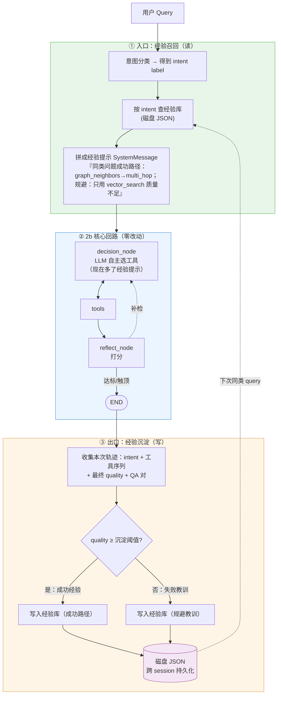

# 创新点 2c · 经验型记忆（Experiential Memory）— 让检索"记住成功，避开弯路"

> 🧬 本文是创新点 2（IntentAgent）家族的**第三次演化**：把现在只存"裸 query 文本、session 隔离、进程内易失"的 `SessionMemory`，升级为**类 Claude Code 式的经验记忆**——把检索过程中沉淀的「成功工具序列 + 反思教训 + 高质量 QA 对」**跨 session 持久化到磁盘**，遇到相似问题时**召回历史经验、直接复用成功路径、提前规避低效弯路**。
>
> 它与创新点 2b（LangGraph 动态编排）**正交且互补**：2b 让 Agent "会自主规划"，2c 让 Agent "从过去的规划中学习"。两者叠加，检索决策从「每次从零试错」跃迁到「经验驱动的快速收敛」。

---

## 📖 目录

- [0. 一句话定位](#0-一句话定位)
- [1. 为什么要做这件事（动机）](#1-为什么要做这件事动机)
- [2. 设计目标与硬约束](#2-设计目标与硬约束)
- [3. 整体架构：经验记忆如何接入 2b 状态图](#3-整体架构经验记忆如何接入-2b-状态图)
- [4. 沉淀什么：三类经验条目](#4-沉淀什么三类经验条目)
- [5. 怎么召回：意图标签做索引键](#5-怎么召回意图标签做索引键)
- [6. 怎么沉淀：检索结束后的经验写回](#6-怎么沉淀检索结束后的经验写回)
- [7. 持久化：类 Claude Code 的磁盘记忆文件](#7-持久化类-claude-code-的磁盘记忆文件)
- [8. 接口设计：扩展 BaseMemory 而非破坏它](#8-接口设计扩展-basememory-而非破坏它)
- [9. 顺势盘活意图分类](#9-顺势盘活意图分类)
- [10. 配置开关](#10-配置开关)
- [11. 与现有架构的兼容性（三条 CI 红线）](#11-与现有架构的兼容性三条-ci-红线)
- [12. 消融实验设计](#12-消融实验设计)
- [13. 测试计划（TDD）](#13-测试计划tdd)
- [14. 风险与权衡](#14-风险与权衡)

---

## 0. 一句话定位

> **从「存历史对话文本、仅用于消解追问指代」的会话记忆，演化为「沉淀检索成功经验、跨 session 持久化、按意图召回复用」的经验记忆。**

它不重写任何检索算法——经验记忆只在 2b 状态图的**入口（读经验作提示）**与**出口（写经验作沉淀）**两处挂钩，对 Decision/Tools/Reflect 的核心逻辑零侵入。

---

## 1. 为什么要做这件事（动机）

### 1.1 现状 gap：当前 `SessionMemory` 是"会话便签"，不是"经验大脑"

对照真实代码（`plugins/intent_agent/memory.py`），现状有四个本质局限：

| 维度 | 现状（`SessionMemory`） | 后果 |
|---|---|---|
| **存什么** | 只存裸 query 字符串（`deque[str]`） | 没有任何"检索过程"信息——调了哪些工具、质量如何、成功与否全部丢失 |
| **怎么用** | 只拼成 `SystemMessage` 给 LLM 消解 `follow_up` 指代 | 对"如何检索得更好"零贡献 |
| **作用范围** | 按 `session_id` 隔离 | 换个 session（甚至换一题）经验就清零，**无法跨问题复用** |
| **持久化** | 进程内 `dict`，重启即失 | 谈不上"沉淀" |

### 1.2 一个必须正视的副作用：动态版里意图分类被"架空"了

创新点 2b 的 `reasoning_node`（`plugins/intent_agent/langgraph/graph.py`）把意图分类结果降级为一句 `"Use it only as a hint"` 的提示——LLM 可以完全无视它，分对分错都不影响可用工具集，反思回路也不依赖它。

**结果是：意图分类在动态版里近乎"空转"**，存在感弱到可被删除而不影响功能。这是一个潜在的"创新点空心化"风险。

### 1.3 一石二鸟：用经验记忆盘活意图分类

经验记忆恰好需要一个**召回索引键**——用什么把"当前 query"匹配到"历史相似问题的成功经验"？**意图标签天然就是这个键**：把经验按 6 类意图分桶沉淀，新 query 分类后直接查同类经验。

于是意图分类从"一句可有可无的提示"升级为"**经验复用的检索键**"，真正获得了存在价值。这就是本创新点"一石二鸟"的设计：**既补齐了经验记忆的召回机制，又赋予了意图分类实质作用**。

---

## 2. 设计目标与硬约束

### 2.1 目标

1. **经验沉淀**：把检索过程中的「成功工具序列 + 反思教训 + 高质量 QA 对」结构化落盘。
2. **经验复用**：新 query 按意图召回同类历史经验，作为 Decision 阶段的强提示，加速收敛、规避低效路径。
3. **跨 session 持久化**：类 Claude Code，记忆写入磁盘文件，重启后仍在、所有 query 共享。
4. **盘活意图分类**：让意图标签成为经验库的索引键，赋予其实质作用。
5. **零侵入**：只在 2b 状态图入口/出口挂钩，不改 Decision/Tools/Reflect 核心逻辑。

### 2.2 硬约束（继承自项目三条红线）

1. `core/` ❌ 不 import `plugins/`
2. `plugins/adagraph/` 与 `plugins/intent_agent/` ❌ 互不依赖
3. 关闭经验记忆（回退到 `SessionMemory` 或 `None`）后，2b / 静态版 / vanilla 仍能端到端跑通

> 本方案选择"**扩展而非替换**"：保留 `SessionMemory` 作为消融基线与降级目标，新代码以增量形式落在 `plugins/intent_agent/` 下新增的经验记忆实现里，对 `BaseMemory` 接口**只增不改**（见 §8）。

---

## 3. 整体架构：经验记忆如何接入 2b 状态图

经验记忆的接入点极简——**只碰 2b 状态图的"头"和"尾"**，中间的 Decision ⇄ Tools ⇄ Reflect 回路一行不动：



**三段式闭环**：

- **① 入口（绿色，读）**：query 先意图分类 → 按 intent 从磁盘经验库捞同类历史经验 → 拼成"经验提示"注入 LLM 对话。这是召回。
- **② 核心（蓝色，零改动）**：完全复用 2b 的 Decision ⇄ Tools ⇄ Reflect 回路，只是 LLM 多看到一段经验提示，更可能一步选对工具。
- **③ 出口（橙色，写）**：本次检索结束后，把"intent + 工具序列 + 最终质量 + QA 对"按质量分流——达标的存为「成功路径」，不达标的存为「规避教训」——落盘。这是沉淀。

**闭环的关键**：③ 写入的磁盘库（紫色）正是 ① 读取的来源。跨 session、跨 query，经验在这个闭环里持续累积，越用越聪明。

---

## 4. 沉淀什么：三类经验条目

经验库里每条记录是一个 `ExperienceEntry`，统一承载你要的三类信息。用 `dataclass` 定义（与项目 `core/types.py` 风格一致）：

```python
@dataclass
class ExperienceEntry:
    # —— 索引字段 ——
    intent: str                       # 6 类意图之一，做分桶索引键（见 §5）
    query_text: str                   # 原始问题，用于二次相似度过滤与人读

    # —— 类型 1：成功工具序列 ——
    tool_sequence: list[str]          # 如 ["graph_neighbors", "multi_hop_retrieve"]
    iterations: int                   # 反思回路实际迭代轮数

    # —— 类型 2：反思教训 ——
    final_quality: float              # 本次最终质量分（来自 HeuristicReflectionHook）
    outcome: str                      # "success" | "lesson"（按沉淀阈值分流）
    lesson: str | None                # 失败教训文本，如"仅 vector_search 质量 0.4，需补图谱跳转"

    # —— 类型 3：高质量 QA 对 ——
    answer_text: str | None           # 仅 success 时保存，作为相似问题的快捷答案候选
    evidence_chunk_ids: list[str]     # 支撑证据，便于复用时直接定位

    # —— 元信息 ——
    created_at: str                   # ISO 时间戳
    hit_count: int = 0                # 被召回复用的次数（用于热度排序/淘汰）
```

三类信息如何对应你的需求：

| 你的需求 | 对应字段 | 复用时的作用 |
|---|---|---|
| **成功的工具调用序列** | `tool_sequence` + `iterations` | 同类问题直接提示"上次这样调成功了"，LLM 少试错 |
| **反思 feedback 教训** | `outcome="lesson"` + `lesson` | 同类问题提示"上次这样做不行"，提前规避低效路径 |
| **高质量 QA 对** | `answer_text` + `evidence_chunk_ids` | 极相似问题可直接给出候选答案/证据作捷径 |

> **数据来源全部现成**：`tool_sequence` 来自 2b 已有的 `state["tool_call_log"]`；`iterations` / `final_quality` 来自 `state["iteration_count"]` / `state["quality"]`；`answer_text` / `evidence_chunk_ids` 来自 `context.merged_result()`。**沉淀不需要新增任何采集逻辑，只是把 2b 已经写进 `metadata` 的东西落盘**。

---

## 5. 怎么召回：意图标签做索引键

### 5.1 召回机制（两级，可渐进）

**第一级（MVP，本方案落地）· 意图分桶精确召回**：

经验库在磁盘上按 `intent` 分桶组织（见 §7 文件结构）。新 query 进来：

1. `reasoning_node` 已经算出了 `intent.label`（复用，零额外成本）；
2. 用该 label 作 key，从经验库捞出**同类**的若干条经验（按 `final_quality` 降序、`hit_count` 加权，取 Top-N，默认 N=3）；
3. 拼成一段结构化经验提示注入对话。

**第二级（可选增强，文档预留）· 桶内向量相似度精排**：

意图分桶把候选缩到同类后，可选地对桶内经验的 `query_text` 做 embedding 相似度排序，取与当前 query 最像的几条。这能从"同类"升级到"同类且相似"，但需要复用 `embedder` 给历史 query 算向量（成本与实现量更高），故列为**后续增强**，MVP 不做。

> **为何不一上来就纯向量召回**：纯向量召回需要维护历史 query 的向量索引（又一套 FAISS），且丢失了"意图"这一层语义结构。意图分桶是**用现成的分类结果免费换来的粗召回**，与"盘活意图分类"的目标一致，是性价比最高的 MVP 选择。

### 5.2 召回结果如何注入

召回到的经验拼成一条 `SystemMessage`，追加在 `reasoning_node` 现有的意图提示之后：

```
[经验提示] 历史上同类（multi_hop）问题的检索经验：
  ✅ 成功路径(quality 0.82)：graph_neighbors(2hop) → multi_hop_retrieve
  ✅ 成功路径(quality 0.75)：vector_search → graph_neighbors(1hop)
  ⚠️ 规避教训：仅用 vector_search 时 quality 仅 0.40，多跳问题需补图谱跳转
请优先参考成功路径，避免已知的低效做法。
```

这条提示进入 LLM 的 Decision 上下文，与 2b 原有的工具目录、意图提示并列。LLM 仍**自主决策**——经验是强先验，不是硬约束（保持 2b 的自主性哲学）。

---

## 6. 怎么沉淀：检索结束后的经验写回

沉淀发生在 `LangGraphAgentRetriever.retrieve()` 的出口（图跑完、`final_state` 拿到之后），逻辑分三步：

1. **组装条目**：从 `final_state` 与 `context.merged_result()` 取齐 §4 的全部字段。
2. **质量分流**（沿用 2b 的 `quality_threshold` 口径，默认 τ=0.6）：
   - `final_quality ≥ τ` → `outcome="success"`，保存完整成功路径 + QA 对；
   - `final_quality < τ` → `outcome="lesson"`，保存工具序列 + 自动生成的规避教训文本（如"仅 {tools} 质量 {q}，建议补 {缺失能力}"），**不存** answer（低质量答案不复用）。
3. **去重写盘**：同 `intent` 桶内，若已存在 `tool_sequence` 相同且 `outcome` 相同的条目，则不新增、只把其 `hit_count`/`final_quality` 做滑动更新；否则追加。

> **沉淀是"机会式"的**：只在检索真正跑完时写一次，不在回路中间写，避免污染。整个写回逻辑约 20 行，挂在 retriever 出口，**不进入状态图节点**，因此对 2b 核心零侵入。

### 6.1 教训文本怎么生成（确定性，不调 LLM）

为保持"零 API key 可测"，规避教训用**规则模板**生成，不调 LLM：

```
lesson = f"intent={intent} 时，工具序列 {tool_sequence} 质量仅 {quality:.2f}；" \
         f"建议补充 {推荐能力}"
```

其中"推荐能力"由一张静态映射给出（如 `multi_hop` 意图缺图谱跳转 → 推荐 `graph_neighbors`/`multi_hop_retrieve`），与现有 `_INTENT_TO_STRATEGY` 同源、可维护。

---

## 7. 持久化：类 Claude Code 的磁盘记忆文件

### 7.1 文件布局

仿 Claude Code 的"项目级记忆目录"，落在仓库可配置路径（默认 `.chimera_memory/`）：

```
.chimera_memory/
├── experience/
│   ├── factual.jsonl          # 每行一条 ExperienceEntry（factual 桶）
│   ├── analytical.jsonl
│   ├── comparative.jsonl
│   ├── multi_hop.jsonl
│   ├── exploratory.jsonl
│   └── follow_up.jsonl
└── index.json                 # 轻量索引：各桶条数、最近更新时间、全局统计
```

- **按意图分桶成文件** → 召回时只读对应一个文件，O(桶大小) 而非全库扫描，与 §5 的意图索引键天然对齐。
- **JSONL 追加写** → 沉淀是 append，避免重写整文件；崩溃也只损失最后一行。
- **`index.json`** → 启动时读它就知道库规模，无需扫全部桶。

### 7.2 容量与淘汰

- 每桶设上限 `max_per_bucket`（默认 200 条）；超限时按 `hit_count` 升序 + `created_at` 升序淘汰（冷且旧的先删）。
- 这保证经验库**有界**，长期运行不膨胀，且高频复用的好经验被保留。

### 7.3 与会话记忆的关系

经验记忆（跨 session、磁盘）与现有会话记忆（session 内、追问指代）**职责不同、可共存**：

| | `SessionMemory`（保留） | `ExperientialMemory`（新增） |
|---|---|---|
| 解决问题 | `follow_up` 指代消解 | 跨问题经验复用 |
| 作用范围 | 单 session | 全局跨 session |
| 存储 | 进程内 deque | 磁盘 JSONL |
| 存内容 | 裸 query 文本 | 结构化经验条目 |

二者可同时启用：会话记忆管"这轮对话的上下文"，经验记忆管"历史所有检索的智慧"。

---

## 8. 接口设计：扩展 BaseMemory 而非破坏它

现有 `BaseMemory`（`interfaces/memory.py`）只有 `append / get_history / clear` 三个会话方法。经验记忆需要新方法，但**不能改 ABC 破坏 `SessionMemory` 兼容性**。方案：**新增一个独立 ABC**，与 `BaseMemory` 并列：

```python
# interfaces/experiential_memory.py（新增，不动 BaseMemory）
class BaseExperientialMemory(ABC):
    @abstractmethod
    def recall(self, intent: str, query_text: str, top_n: int = 3) -> list[ExperienceEntry]: ...

    @abstractmethod
    def remember(self, entry: ExperienceEntry) -> None: ...

    @abstractmethod
    def stats(self) -> dict: ...
```

- `SessionMemory` 继续实现 `BaseMemory`，**完全不动**；
- 新增 `FileExperientialMemory` 实现 `BaseExperientialMemory`，注册名 `intent_agent.experiential`；
- `LangGraphAgentRetriever` 新增一个**可选**依赖 `experiential_memory: BaseExperientialMemory | None = None`，为 `None` 时行为与 2b 完全一致（降级）。

这样三条红线全保（见 §11），且 `git diff` 是纯增量。

---

## 9. 顺势盘活意图分类

本创新点让意图分类获得**两个实质作用**，从 2b 的"近乎空转"中翻身：

1. **经验召回的索引键**（§5）：意图标签决定从哪个桶捞经验。分类质量直接影响召回相关性——分对了才能捞到真正同类的经验。
2. **经验沉淀的分桶键**（§6/§7）：写回时按意图归档，使经验库具备语义结构。

> **副作用：意图分类的评测有了抓手**。过去动态版里意图分类对最终指标几乎无影响，难以证明其价值；接入经验记忆后，可在消融实验里对比"意图分桶召回 vs 随机召回 vs 不召回"，**定量证明意图分类的贡献**——这恰好补上了 2b 留下的"创新点空心化"漏洞。

---

## 10. 配置开关

复用现有 `query.retriever` 与 `plugins.intent_agent` 结构，新增经验记忆子节点：

```yaml
query:
  retriever:
    active: intent_agent.langgraph
    params:
      top_k: 5
      # 经验记忆开关（新增；缺省关闭 → 行为等同纯 2b）
      experiential_memory:
        enabled: true
        path: .chimera_memory                 # 磁盘记忆目录
        recall_top_n: 3                        # 每次召回的经验条数
        max_per_bucket: 200                    # 每个意图桶容量上限
        # 沉淀阈值复用 2b 的 quality_threshold，不另造字段
```

- **沉淀阈值**直接复用 §6 提到的 `quality_threshold`（2b 已有，默认 0.6），不新增。
- `enabled: false` 或整节缺省 → retriever 不注入 `experiential_memory`，**完全退化为 2b**。

---

## 11. 与现有架构的兼容性（三条 CI 红线）

| 红线 | 是否满足 | 说明 |
|---|---|---|
| `core/` 不依赖 `plugins/` | ✅ | 经验记忆全部落在 `interfaces/`（新 ABC）+ `plugins/intent_agent/`；`core` 不动 |
| 两 plugin 互不依赖 | ✅ | 不 import `plugins/adagraph/`；只读 `PipelineState` 与现有意图分类结果 |
| 关插件可降级 | ✅ | `experiential_memory=None` 即退化为 2b；2b 关掉则退化为静态版/vanilla，逐级可降 |

跨边界调用仍只走 `interfaces/*` ABC + `registry`，`tests/test_plugin_toggle_regression.py` 守护的依赖方向不被打破。

---

## 12. 消融实验设计

经验记忆带来**新的对照维度**——"有无经验复用"。在 2b 基础上扩展：

| 配置 | 检索器 | 经验记忆 | 回答的问题 |
|---|---|:---:|---|
| `deepseek_intent_langgraph` | `intent_agent.langgraph` | ❌ | 2b 动态编排基线 |
| **`deepseek_langgraph_memory`** | `intent_agent.langgraph` | ✅ | **经验记忆带来的增量** |
| `deepseek_langgraph_memory_random` | `intent_agent.langgraph` | ✅（随机召回） | 隔离"意图分桶召回"vs"随机召回"，证明意图分类的贡献 |

核心观测：

- **收敛速度**：平均 `iterations`（反思迭代轮数）应随经验积累**下降**——经验让 LLM 更快选对工具。
- **质量增益**：EM / F1 / ROUGE-L，尤其 `multi_hop` / `comparative` 这类需要多工具组合的意图。
- **经验命中率**：召回经验的 `hit_count` 增长曲线、命中后是否真被 LLM 采纳。
- **冷启动 vs 热启动**：同一数据集跑两遍，第二遍（库已暖）应显著优于第一遍（库空），直接证明"越用越聪明"。

实验文档建议补到 `docs/experiments/`，与 2b 实验并列。

---

## 13. 测试计划（TDD）

沿用 RED → GREEN → REFACTOR → COMMIT，全部用 MockProvider，零 API key：

| 测试文件 | 覆盖点 |
|---|---|
| `tests/test_experiential_memory_store.py` | `FileExperientialMemory` 的 `remember/recall/stats`；JSONL 落盘与重载；分桶正确性；容量淘汰 |
| `tests/test_experiential_memory_recall.py` | 按 intent 召回同类经验；Top-N 排序（quality + hit_count 加权）；空桶返回空 |
| `tests/test_experiential_memory_writeback.py` | 出口沉淀：质量分流（success/lesson）、教训模板生成、去重更新 hit_count |
| `tests/test_langgraph_with_memory.py` | retriever 注入经验记忆后端到端跑通；提示注入；冷/热两遍行为差异 |
| `tests/test_experiential_memory_degradation.py` | `experiential_memory=None` 时行为 == 纯 2b；目录不存在时自动创建/优雅处理 |

并补充进 `test_plugin_toggle_regression.py`，确保三条红线不破。

---

## 14. 风险与权衡

| 风险 | 影响 | 缓解 |
|---|---|---|
| 经验"污染"——把偶然成功的坏路径当经验 | 误导后续检索 | 沉淀阈值 + 去重时滑动更新质量；低质量只存 lesson 不存 answer；`hit_count` 淘汰冷经验 |
| 意图分错 → 召回到不相关经验 | 经验提示帮倒忙 | 经验仅作"强先验"非硬约束，LLM 可无视；§5.2 桶内相似度精排（后续）可进一步过滤 |
| 磁盘库无限膨胀 | 长期运行变慢 | 每桶 `max_per_bucket` 上限 + 冷旧淘汰，库恒有界 |
| 并发写盘冲突 | JSONL 损坏 | append 写 + 行级原子；MVP 单进程；多进程场景留文件锁作后续增强 |
| 与 `SessionMemory` 职责混淆 | 设计不清 | §7.3 明确二者正交可共存，接口层用独立 ABC 隔离（§8） |
| MockProvider 无真实推理 | 测试只验流程不验质量 | 流程用 Mock 覆盖；质量增益在 §12 真实 LLM 冷/热对照里验证 |

---

## 📎 关联文档

| 文档 | 关系 |
|---|---|
| [`innovation_2b_langgraph_agent.md`](innovation_2b_langgraph_agent.md) | 本文的宿主：经验记忆挂在 2b 状态图的入口/出口，复用其 `tool_call_log` / `quality` |
| [`innovation_2_intent_agent.md`](innovation_2_intent_agent.md) | 意图分类、`SessionMemory`、6 类意图的来源，本文在其上扩展 |
| [`architecture_overview.md`](architecture_overview.md) | 注册表 / 插槽 / 依赖注入骨架，新经验记忆按此骨架接入 |
