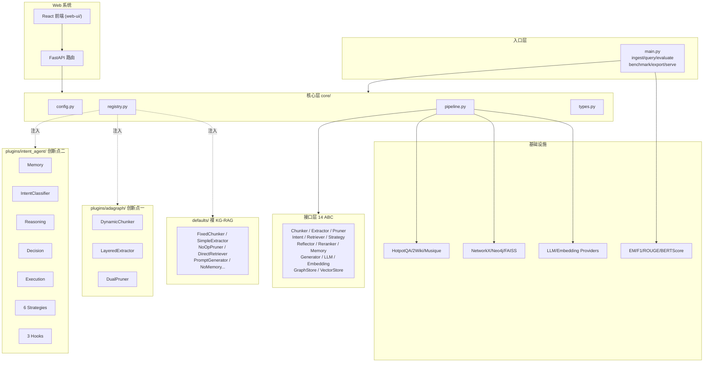

## 产品概述

从零自研一个名为 **Chimera-RAG** 的基于知识图谱的可插拔 RAG 框架，并配套 FastAPI Web 演示系统与 React 前端。框架默认即为一个可工作的"裸 KG-RAG"基线；两个研究创新点 **AdaGraph**（知识构建双重增强，原 DEKER）与 **IntentAgent**（意图感知智能体，原 MRDE）作为可通过 `config.yaml` 一键开关的独立插件叠加其上。主入口 `main.py` 支持 `ingest / query / evaluate / benchmark / export / serve` 六个子命令。

## 核心功能

- **裸 KG-RAG 基线**：固定分块 + LLM 显式三元组提取 + NetworkX 图存储 + FAISS 向量索引 + 直接检索 + LLM 生成，端到端可跑通，两个创新点完全关闭时正常工作
- **创新点一 AdaGraph 骨架**：动态粒度分块器（自适应公式实装）、分层四级三元组提取器（L1 实装，L2-L4 TODO）、双重冗余剪枝器（相似性实装，传递性 TODO）
- **创新点二 IntentAgent 骨架**：Memory / Reasoning（6 类意图）/ Decision（6 策略）/ Execution（反馈循环）四模块 + Reflection / Reranking / ParallelPool 三个可插拔 Hook
- **插件注册表**：抽象基类 + `@register(slot, name)` 装饰器 + Registry 单例 + `config.<slot>.active` 查表注入；未找到时降级到 defaults
- **全量 config.yaml**：单文件覆盖 app / logging / llm / embedding / storage / datasets / ingestion / query / plugins / web / evaluation 十大配置域
- **统一入口 main.py**：`ingest / query / evaluate / benchmark / export / serve` 六个子命令，`--config` 和 `--dataset` 参数贯穿
- **FastAPI Web 系统**：ingest 可视化、查询与答案展示、知识图谱可视化、检索过程追踪、插件实时开关、数据集评测、config 在线编辑七大功能；前端 React + Vite + Tailwind + shadcn/ui，构建产物挂载到 FastAPI 单端口部署
- **数据集适配**：HotpotQA / 2WikiMultihopQA / MusiqueQA / 通用 jsonl / 纯文本，统一 `DatasetLoader` 接口
- **评测闭环**：EM / F1 / ROUGE / BERTScore 指标实现，支持 benchmark 对比多配置
- **测试覆盖**：pytest 覆盖注册表、端到端、插件降级、数据集加载、评测指标、Web API 六大场景，全部使用 MockProvider 无需真实 API

## 技术栈

### 包管理

- **uv**：全项目统一使用 `uv` 管理 Python 依赖与虚拟环境，不使用 pip / poetry / conda
- 初始化：`uv init --package --lib`（src layout）或 `uv venv` 创建虚拟环境
- 安装：`uv sync --all-extras --dev` 一键安装主依赖 + 所有 extras + dev 依赖
- 运行：`uv run python main.py ...` / `uv run pytest -q` / `uv run chimera ...` 无需手动激活 venv
- 锁文件：提交 `uv.lock` 保证可复现构建；`pyproject.toml` 中 `[tool.uv]` 段声明 dev-dependencies 与 extras
- 新增依赖：`uv add <pkg>` / `uv add --optional web fastapi` / `uv add --dev pytest`

### 后端核心

- **Python** 3.11+，src layout，`uv sync --all-extras --dev` 编辑安装
- **编排**：自研轻量 Pipeline（非 LangChain/LlamaIndex，保证创新点可见性）
- **图/向量**：`networkx` + `faiss-cpu`（MVP），`neo4j` 预留接口
- **数据契约**：`pydantic` >= 2.0 全链路强类型
- **LLM/Embedding**：`openai` SDK（兼容 DeepSeek）+ `httpx`（Ollama）+ MockProvider
- **重试与日志**：`tenacity` + `rich`

### Web 后端

- `FastAPI` + `uvicorn` + `python-multipart` + `sse-starlette`（进度流式推送）
- 后台任务队列：`asyncio.Queue` 轻量实现（不引入 Celery）

### 前端

- `React` 18 + `Vite` + `TypeScript` + `Tailwind CSS` + `shadcn/ui`
- 图谱可视化：`cytoscape` + `react-cytoscapejs`
- YAML 编辑：`@monaco-editor/react`
- HTTP：`axios` + `react-router-dom` + `zustand`（轻量状态管理）

### 评测

- `rouge-score` + `bert-score`（extras[eval]，可选）

### 测试与质量

- `pytest` + `pytest-asyncio` + `httpx.AsyncClient`（FastAPI TestClient）
- `black` + `ruff`

## 架构总览



## 实施策略

**主路径**：注册表驱动的依赖注入管线。Pipeline 只认 ABC 接口，通过 Registry 按 `config.<slot>.active` 查表注入具体实现；关闭创新点就是改一行 yaml，降级到 defaults。

**关键决策与权衡**：

1. **Chimera 的象征**：希腊神话融合体对应"知识构建 × 智能检索"双头并存，契合双创新点架构
2. **main.py 放根目录**：便于 `uv run python main.py xxx` 直接运行；内部通过 `from chimera_rag import ChimeraRAG` 调用
3. **Web 单端口部署**：前端 `pnpm build` 产物拷贝到 `src/chimera_rag/web/static/`，FastAPI 通过 StaticFiles 挂载 `/`，避免跨域与部署复杂度
4. **插件热切换**：`POST /api/plugins/toggle` 改 config 后重建 Pipeline 实例但复用 GraphStore/VectorStore，避免重复 ingest
5. **SSE 进度推送**：ingest 和 evaluate 两个耗时任务通过 `sse-starlette` 推送实时进度，前端用 EventSource 订阅
6. **数据集加载器解耦**：`BaseDatasetLoader.load(split, limit)` 统一接口；HotpotQA 等大数据文件路径通过 `config.datasets.<name>.path` 配置，不入库
7. **零 API 测试**：所有测试默认用 `MockLLMProvider` + `MockEmbeddingProvider`，`pytest -q` CI 友好

**性能要点**：

- Embedding 批量 encode（ingest 时一次性处理全部 chunks）
- FAISS `IndexFlatIP` 持久化到 `.faiss + .pkl`，query 冷启动复用
- LLM 调用 tenacity 指数退避重试（3 次，10s 上限）
- 前端图谱可视化启用 cytoscape 的 `cose-bilkent` 布局 + 节点数 > 500 降级为 `grid`

## 目录结构

```
/Users/teng/Projects/my/agent-graph-rag/
├── main.py                                   # [NEW] 统一入口，argparse 六个子命令
├── pyproject.toml                            # [NEW] 包名 chimera-rag，src layout，extras[web,eval,st,neo4j,spacy,dev]，[tool.uv] 声明 uv 管理
├── uv.lock                                   # [NEW] uv 锁文件，提交到版本库保证可复现
├── README.md                                 # [NEW] 项目概述 / 架构图 / Quick Start（uv sync / uv run）/ 插件开发指南
├── .gitignore                                # [NEW] Python 通用 + .env + data/ + output/ + web-ui/node_modules + .venv/ （uv.lock 不忽略）
├── .python-version                           # [NEW] uv 默认读取，固定为 3.11
├── .env.example                              # [NEW] LLM_PROVIDER / OPENAI_API_KEY / OPENAI_BASE_URL / OLLAMA_HOST
│
├── configs/                                  # [NEW] 五份 yaml，按"全字段注释"原则编写
│   ├── default.yaml                          # 参考模板，含所有字段+注释
│   ├── vanilla.yaml                          # 裸 KG-RAG（AdaGraph+IntentAgent 全关）
│   ├── adagraph_only.yaml                    # 仅 AdaGraph
│   ├── intent_agent_only.yaml                # 仅 IntentAgent
│   └── full.yaml                             # 全启用
│
├── src/chimera_rag/                          # [NEW] 主包 src layout
│   ├── __init__.py                           # 暴露 ChimeraRAG 主类 + __version__
│   ├── cli.py                                # CLI 子命令实现（被 main.py 调用）
│   │
│   ├── core/                                 # 核心层，禁止 import plugins/*
│   │   ├── __init__.py
│   │   ├── types.py                          # Pydantic 数据模型：Document/Chunk/Triple/Entity/Query/Intent/ReasoningPlan/RetrievalResult/Answer/QualityFeedback/QAExample/EvalResult
│   │   ├── config.py                         # 配置加载：yaml+env+Pydantic 校验；AppConfig 总模型 + SlotConfig 子模型
│   │   ├── registry.py                       # @register(slot,name) 装饰器 + Registry 单例 + get_or_default + list_slot
│   │   ├── pipeline.py                       # IngestionPipeline + QueryPipeline 两个编排类，依赖注入
│   │   ├── logging.py                        # rich handler + 结构化打点
│   │   └── exceptions.py                     # ChimeraError + PluginNotFound/ConfigError/ProviderError/DatasetError
│   │
│   ├── interfaces/                           # 14 个 ABC
│   │   ├── __init__.py
│   │   ├── chunker.py                        # BaseChunker
│   │   ├── extractor.py                      # BaseTripleExtractor
│   │   ├── pruner.py                         # BasePruner
│   │   ├── intent_classifier.py              # BaseIntentClassifier
│   │   ├── retriever.py                      # BaseRetriever
│   │   ├── strategy.py                       # BaseRetrievalStrategy (async)
│   │   ├── reflector.py                      # BaseReflector (async)
│   │   ├── reranker.py                       # BaseReranker (async)
│   │   ├── memory.py                         # BaseMemory
│   │   ├── generator.py                      # BaseAnswerGenerator
│   │   ├── llm_provider.py                   # BaseLLMProvider (async)
│   │   ├── embedding_provider.py             # BaseEmbeddingProvider
│   │   ├── graph_store.py                    # BaseGraphStore
│   │   └── vector_store.py                   # BaseVectorStore
│   │
│   ├── defaults/                             # 9 个裸实现，通过 @register 注册为 defaults.*
│   │   ├── __init__.py                       # import 所有子模块触发注册
│   │   ├── fixed_chunker.py                  # FixedSizeChunker：token 固定窗口 + overlap
│   │   ├── llm_extractor.py                  # SimpleLLMExtractor：单 prompt 提取显式三元组 + JSON 解析
│   │   ├── noop_pruner.py                    # NoOpPruner：原样返回
│   │   ├── rule_intent_classifier.py         # RuleBasedIntentClassifier：全部归为 factual
│   │   ├── direct_retriever.py               # DirectRetriever：向量 top-k + 1 跳邻居扩展
│   │   ├── prompt_generator.py               # PromptBasedGenerator：context+query → LLM → Answer
│   │   ├── no_memory.py                      # NoMemory：无状态实现
│   │   ├── no_reflection.py                  # NoOpReflector：永返回 quality=1.0
│   │   └── no_reranker.py                    # NoOpReranker：原序返回
│   │
│   ├── providers/                            # LLM / Embedding 接入
│   │   ├── __init__.py                       # from_config 工厂
│   │   ├── llm/
│   │   │   ├── __init__.py
│   │   │   ├── openai_provider.py            # 兼容 OpenAI/DeepSeek，tenacity 重试
│   │   │   ├── ollama_provider.py            # httpx /api/chat
│   │   │   └── mock_provider.py              # 按 prompt 关键词返回预设响应
│   │   └── embedding/
│   │       ├── __init__.py
│   │       ├── openai_embedding.py
│   │       ├── ollama_embedding.py
│   │       ├── sentence_transformer_embedding.py  # extras[st]
│   │       └── mock_embedding.py             # hash → 确定性向量
│   │
│   ├── stores/                               # 图/向量存储
│   │   ├── __init__.py
│   │   ├── graph/
│   │   │   ├── __init__.py
│   │   │   ├── networkx_store.py             # NetworkXGraphStore 实装（add_triple/get_neighbors/persist pickle）
│   │   │   └── neo4j_store.py                # Neo4jGraphStore 占位：方法签名齐全，raise NotImplementedError + docstring
│   │   └── vector/
│   │       ├── __init__.py
│   │       └── faiss_store.py                # FAISSVectorStore：IndexFlatIP，持久化 .faiss + .pkl
│   │
│   ├── plugins/                              # 两大创新点，与 defaults 平级
│   │   ├── __init__.py                       # 根据 config.plugins.<name>.enabled 动态 importlib 子包
│   │   ├── adagraph/                         # 创新点一（原 DEKER）
│   │   │   ├── __init__.py                   # @register("chunker","adagraph.dynamic") 等
│   │   │   ├── config_schema.py              # AdaGraphConfig Pydantic
│   │   │   ├── dynamic_chunker.py            # DynamicChunker：complexity/density 方法骨架（可 stub 0.5），compute_adaptive_chunk_size 公式实装，句子级分块循环实装
│   │   │   ├── layered_extractor.py          # LayeredExtractor：L1 实装复用 SimpleLLMExtractor；L2(coref/causal/temporal) / L3(schema) / L4(cross-sent) TODO 返回空列表 + warning
│   │   │   └── dual_pruner.py                # DualRedundancyPruner：相似性冗余聚类实装（embedding cosine+阈值）；传递性冗余 TODO
│   │   │
│   │   └── intent_agent/                     # 创新点二（原 MRDE）
│   │       ├── __init__.py                   # 注册所有 intent_agent.* 组件
│   │       ├── config_schema.py              # IntentAgentConfig：max_history / quality_threshold / enabled_hooks / strategies 子配置
│   │       ├── agent.py                      # IntentAgent 主入口：process_query 串联 M-R-D-E
│   │       ├── memory.py                     # SessionMemory + InMemorySessionStorage，实装
│   │       ├── intent_classifier.py          # LLMIntentClassifier + 规则兜底：6 类意图，实装
│   │       ├── reasoning.py                  # IntentReasoner：意图→ReasoningPlan 映射表，实装
│   │       ├── decision.py                   # StrategySelector：根据 plan.strategy_name 从策略注册表取实例
│   │       ├── execution.py                  # AdaptiveExecutor：主 while 循环骨架 + Reflector 质量评估 + 反馈调整 TODO
│   │       ├── strategies/
│   │       │   ├── __init__.py
│   │       │   ├── direct.py                 # 复用 DirectRetriever，实装
│   │       │   ├── multi_hop.py              # BFS 2-hop 骨架
│   │       │   ├── parallel.py               # asyncio.gather 骨架
│   │       │   ├── iterative.py              # 分解-检索-组合骨架
│   │       │   ├── expansion.py              # 邻居扩展骨架
│   │       │   └── context_aware.py          # 复用 Memory 骨架
│   │       └── hooks/
│   │           ├── __init__.py
│   │           ├── reflection_hook.py        # LLMReflectionHook：LLM 评估 relevance/completeness 骨架
│   │           ├── reranking_hook.py         # CrossEncoderRerankingHook：cross-encoder 骨架
│   │           └── parallel_pool_hook.py     # ParallelRetrievalPool：asyncio 子检索池骨架
│   │
│   ├── datasets/                             # 数据集加载
│   │   ├── __init__.py                       # 注册表：name → loader class
│   │   ├── base.py                           # BaseDatasetLoader.load(split, limit) -> List[QAExample]
│   │   ├── hotpotqa.py                       # HotpotQALoader
│   │   ├── two_wiki.py                       # TwoWikiLoader
│   │   ├── musique.py                        # MusiqueLoader
│   │   ├── generic_jsonl.py                  # GenericJsonlLoader（通用 jsonl，字段映射通过 config）
│   │   └── plain_text.py                     # PlainTextLoader（纯 txt，按段落切）
│   │
│   ├── evaluation/                           # 评测
│   │   ├── __init__.py
│   │   ├── metrics.py                        # exact_match / token_f1 / rouge_l / bertscore（bertscore 可选 extras）
│   │   └── evaluator.py                      # Evaluator.run(dataset, pipeline, metrics) -> EvalResult
│   │
│   └── web/                                  # FastAPI Web 系统
│       ├── __init__.py
│       ├── app.py                            # create_app(config) 工厂：挂路由 + 挂静态文件 + 中间件
│       ├── deps.py                           # get_chimera / get_config 依赖注入
│       ├── schemas.py                        # 请求响应 Pydantic 模型：IngestRequest/QueryRequest/GraphResponse...
│       ├── tasks.py                          # 异步任务管理器：task_id → status / progress / result；asyncio.Queue + 内存字典
│       ├── sse.py                            # SSE 进度推送工具
│       ├── routers/
│       │   ├── __init__.py
│       │   ├── ingest.py                     # POST /api/ingest + GET /api/ingest/status/{task_id} (SSE)
│       │   ├── query.py                      # POST /api/query 返回 answer+intent+strategy+trace
│       │   ├── graph.py                      # GET /api/graph (子图) + GET /api/graph/stats
│       │   ├── evaluate.py                   # POST /api/evaluate + GET /api/evaluate/results/{task_id}
│       │   ├── config.py                     # GET/PUT /api/config（脱敏 api_key）
│       │   ├── plugins.py                    # GET /api/plugins + POST /api/plugins/toggle（热切换）
│       │   └── trace.py                      # GET /api/trace/{query_id}
│       └── static/                           # 前端构建产物挂载点（web-ui/dist 拷入）
│
├── web-ui/                                   # [NEW] 前端独立项目（React+Vite+TS+Tailwind+shadcn）
│   ├── package.json
│   ├── vite.config.ts                        # 配置 proxy /api → http://localhost:8000
│   ├── tsconfig.json / tsconfig.node.json
│   ├── tailwind.config.ts / postcss.config.js
│   ├── index.html
│   ├── README.md                             # 开发/构建说明
│   └── src/
│       ├── main.tsx
│       ├── App.tsx                           # 顶层路由 + Layout
│       ├── routes/
│       │   ├── IngestPage.tsx                # 文件上传 + 数据集选择 + SSE 进度
│       │   ├── QueryPage.tsx                 # 查询框 + 答案卡片 + 意图/策略标签 + 证据链 + 追踪面板
│       │   ├── GraphPage.tsx                 # Cytoscape 图谱 + 搜索/筛选/详情
│       │   ├── EvaluatePage.tsx              # 上传评测集 + 选配置 + 结果表格/图表
│       │   ├── PluginsPage.tsx               # 插件卡片 + 实时开关
│       │   ├── ConfigPage.tsx                # Monaco YAML 编辑器 + 校验
│       │   └── TracePage.tsx                 # 历史追踪列表
│       ├── components/
│       │   ├── ui/                           # shadcn/ui 生成组件
│       │   ├── Layout.tsx                    # 侧边栏 + 顶栏
│       │   ├── IntentBadge.tsx
│       │   ├── StrategyBadge.tsx
│       │   ├── EvidenceCard.tsx
│       │   ├── GraphViewer.tsx               # cytoscape 封装
│       │   └── ProgressStream.tsx            # EventSource 进度条
│       ├── hooks/
│       │   └── useApi.ts                     # axios 封装 + SSE hook
│       ├── lib/
│       │   ├── api.ts                        # API client 类型化
│       │   └── utils.ts                      # cn / formatDate 等
│       └── store/
│           └── useAppStore.ts                # zustand 全局状态
│
├── examples/                                 # [NEW] 四份端到端 demo
│   ├── demo_vanilla.py
│   ├── demo_adagraph.py
│   ├── demo_intent_agent.py
│   ├── demo_full.py
│   └── data/sample.txt                       # 示例文本（3-5 段英文，含多跳事实）
│
├── data/                                     # [NEW] 数据目录（gitignore）
│   └── README.md                             # 说明如何下载 HotpotQA/2Wiki/Musique
│
└── tests/                                    # [NEW] pytest 全套
    ├── conftest.py                           # mock_llm / mock_embedding / tmp_workspace / sample_config 夹具
    ├── test_registry.py
    ├── test_config.py
    ├── test_types.py
    ├── test_pipeline_vanilla.py              # 端到端：ingest → query 用 MockProvider
    ├── test_plugins_disabled.py              # 启用 config 但卸载插件模块，验证降级
    ├── test_defaults_chunker.py
    ├── test_defaults_extractor.py
    ├── test_adagraph_dynamic_chunker.py      # compute_adaptive_chunk_size 在 score=0/0.5/1 边界
    ├── test_adagraph_layered_extractor.py
    ├── test_adagraph_dual_pruner.py
    ├── test_intent_agent_classifier.py       # 6 类意图 mock 分类
    ├── test_intent_agent_strategies.py
    ├── test_intent_agent_agent.py            # 四阶段串联
    ├── test_stores_faiss.py                  # 持久化 round-trip
    ├── test_stores_networkx.py
    ├── test_datasets_hotpotqa.py             # 加载小样本验证字段映射
    ├── test_datasets_generic_jsonl.py
    ├── test_evaluation_metrics.py            # EM/F1 已知输入验证
    └── test_web_api.py                       # FastAPI TestClient：所有路由 200 + 关键字段
```

## 关键代码结构

```python
# src/chimera_rag/core/registry.py
class Registry:
    """全局插件注册表。slot ∈ {chunker, extractor, pruner,
    intent_classifier, retriever, strategy, reranker, reflector,
    memory, generator, llm_provider, embedding_provider,
    graph_store, vector_store}"""
    def register(self, slot: str, name: str) -> Callable: ...
    def get(self, slot: str, name: str) -> Type: ...
    def get_or_default(self, slot: str, name: str, default: str) -> Type: ...
    def list_slot(self, slot: str) -> list[str]: ...

# src/chimera_rag/core/config.py —— 单文件 config.yaml 的 Pydantic 总模型
class AppConfig(BaseModel):
    app: AppMeta
    logging: LoggingConfig
    llm: LLMConfig
    embedding: EmbeddingConfig
    storage: StorageConfig                # graph + vector
    datasets: dict[str, DatasetConfig]    # 命名数据集条目
    ingestion: IngestionConfig            # chunker/extractor/pruner slot + params
    query: QueryConfig                    # intent_classifier/retriever/generator slot + params
    plugins: PluginsConfig                # adagraph + intent_agent 子配置
    web: WebConfig                        # host/port/cors
    evaluation: EvaluationConfig          # metrics/max_samples/parallel

# main.py 根目录入口
def main():
    parser = argparse.ArgumentParser(prog="chimera")
    sub = parser.add_subparsers(dest="cmd", required=True)
    for name in ["ingest","query","evaluate","benchmark","export","serve"]:
        add_subcommand(sub, name)  # 各自委托到 chimera_rag.cli.<name>
    args = parser.parse_args()
    dispatch(args)
```

## 实施注意事项

- **依赖方向强约束**：`core/` 不 import `defaults/` 和 `plugins/`；Pipeline 全部走 Registry
- **插件动态加载**：`ChimeraRAG.__init__` 根据 `config.plugins.<name>.enabled` 显式 `importlib.import_module("chimera_rag.plugins.<name>")` 触发 `@register` 副作用；未启用不导入避免可选依赖缺失
- **Web 单端口部署**：`web-ui` 的 `pnpm build` 产物自动拷贝到 `src/chimera_rag/web/static/`（由 main.py 的 `serve` 子命令构建时完成或手动执行）；FastAPI 用 `StaticFiles(directory=..., html=True)` 挂载 `/`；dev 模式下前端 Vite 跑 5173 端口并 proxy `/api` 到 8000
- **CORS**：dev 模式后端开启 `allow_origins=["http://localhost:5173"]`，生产同端口无跨域问题
- **插件热切换**：`POST /api/plugins/toggle` 改运行时 config 后重建 `IngestionPipeline` / `QueryPipeline` 但复用 `GraphStore` / `VectorStore` 实例（避免重新 ingest）
- **SSE 进度推送**：ingest 和 evaluate 耗时任务通过 `sse-starlette.EventSourceResponse` 推送，前端用 `EventSource` 订阅
- **配置脱敏**：`GET /api/config` 返回时 `openai.api_key` 等敏感字段替换为 `"****"`；`PUT` 时若收到 `"****"` 保留原值
- **Mock 优先**：所有 pytest 默认用 `MockLLMProvider` + `MockEmbeddingProvider`，`pytest -q` 不需真实 API key
- **数据集文件不入库**：`data/` 加入 `.gitignore`，仅保留 `data/README.md` 说明下载方式；`config.datasets.<name>.path` 指向本地绝对路径或相对 workspace 路径
- **名字映射记录**：README 中声明"AdaGraph（原设计文档中的 DEKER）/ IntentAgent（原设计文档中的 MRDE）"，避免读者混淆
- **不修改 my/ 下 5 份材料**，仅新建项目骨架与 web-ui/
- **性能与降级**：cytoscape 渲染节点 > 500 时降级布局；FAISS 索引 > 10k 时考虑 IVF（本阶段不做）

## 设计风格

面向硕士研究演示与答辩场景的**现代化极简学术风**，兼顾数据可视化的专业感与交互细节的精致感。采用深色主题为主（便于长时间展示），浅色主题可切换；整体以灰度 + 单色强调（青色系）为主色，意图标签与策略标签使用不同色彩编码便于快速识别。布局遵循"左侧导航 + 顶栏状态 + 主内容区"的标准后台模式，各功能页面共用一致的卡片、徽章、表格组件。

## 页面规划（7 个主页面）

### 1. IngestPage 文档上传与构建

顶部：数据集选择下拉 + 文件上传拖拽区。中部：构建参数概览（当前激活的 chunker / extractor / pruner 名称徽章）。下部：SSE 进度条 + 实时日志流 + 构建完成后的统计卡片（文档数 / 分块数 / 三元组数 / 节点数 / 边数）。

### 2. QueryPage 查询与答案

顶部：查询输入框 + 提交按钮 + 会话切换。中部左：答案卡片（含置信度、意图徽章、策略徽章）；中部右：证据链列表（每条证据显示来源 chunk + 相似度分数）。底部可折叠：完整检索追踪面板（chunks → intent → strategy → rerank → reflection 时间线）。

### 3. GraphPage 知识图谱可视化

全屏 cytoscape 画布 + 右侧抽屉。左上浮窗：实体搜索 + 类型筛选 + 布局切换（cose-bilkent / grid / concentric）。点击节点：右侧抽屉显示节点详情（连接的三元组、来源 chunks）。支持子图导出为 PNG / JSON。

### 4. EvaluatePage 数据集评测

上部：评测集选择 + 对比配置多选（vanilla / adagraph_only / intent_agent_only / full）+ 样本上限 + 启动按钮。中部：SSE 进度。下部：结果表格（每行一个配置，列为 EM / F1 / ROUGE-L / BERTScore / 平均延迟）+ 雷达图可视化差异。

### 5. PluginsPage 插件开关面板

卡片式布局，每个插件一张卡（AdaGraph 卡显示 dynamic_chunker / layered_extractor / dual_pruner 三个子组件状态；IntentAgent 卡显示 memory / intent_classifier / 四阶段 / 三个 hooks 状态）。每张卡右上角一个大开关，切换后立即热重建 Pipeline 并 toast 提示。

### 6. ConfigPage 配置在线编辑

左右两栏：左侧 Monaco YAML 编辑器（深色主题），右侧 schema 文档 + 实时校验错误列表。底部：Save / Reset / Validate 三按钮。Save 后调用 `PUT /api/config` 热加载。

### 7. TracePage 历史追踪

列表式：每行一次查询（时间 / query / intent / strategy / 质量分 / 延迟）。点击展开详情：与 QueryPage 的追踪面板样式一致。支持按意图 / 策略筛选。

## Agent Extensions

### SubAgent

- **code-explorer**
- Purpose: 工作区需要新建 60+ 文件、20+ 目录；在动工前以及关键里程碑复核 my/ 下 5 份设计材料的具体公式、prompt 模板、意图分类示例，为 AdaGraph 公式实装和 IntentAgent prompt 提供 ground truth；同时在前后端联调阶段跨文件验证 API 契约一致性
- Expected outcome: 精确提取 my/ 材料中 DEKER 自适应分块公式、MRDE 6 类意图 prompt、冗余阈值等关键数值；给出跨模块一致性检查报告

### Skill

- **humanizer-zh**
- Purpose: README.md、configs/default.yaml 的字段中文注释、plugins 各模块 docstring（尤其是解释创新点动机的段落）需要自然的中文表达，答辩展示时避免 AI 写作痕迹
- Expected outcome: 核心中文文档与注释去除模板化连接词（首先/其次/综上所述）和夸张表述，读起来像研究者本人撰写

- **frontend-design**
- Purpose: web-ui/ 作为研究演示前端，视觉品质直接影响答辩观感；需要该 skill 指导 7 个页面的 shadcn 组件组合、图谱可视化交互、深色主题配色、数据密集页面（评测 / 追踪）的信息密度控制
- Expected outcome: 产出高质量的 React + Tailwind + shadcn 组件代码与交互细节，达到"学术演示 + 工程仪表盘"的专业观感